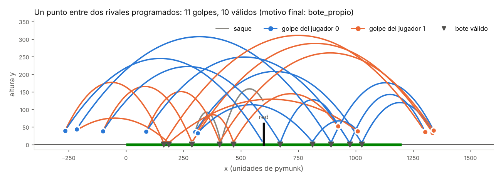

# Capítulo 1 · Física y reglas (F1)

> Etiqueta: `fase-1` · Archivos nuevos: `mundo.py`, `jugador.py`, `arbitro.py`,
> `partido.py`, `rivales.py`, `tests/test_arbitro.py`, `tests/test_fisica.py`,
> `tests/test_partido.py`

## 1.1 Dónde estamos

Tenemos las interfaces (capítulo 0), pero nada que se mueva. En esta fase
construimos el **juego**: una cancha con gravedad, una pelota que rebota, dos
cubos con raqueta y un árbitro que aplica las reglas. Al final, dos jugadores
escritos a mano (los "rivales programados") tienen que poder **pelotear**.

¿Por qué esto va primero? Porque la neuroevolución (capítulos 3 a 6) no
aprende en el vacío: aprende *a jugar este juego*. Si el juego tiene un error,
por ejemplo una pelota que atraviesa la raqueta, la evolución lo va a encontrar
y explotar antes que nosotros. Un juego defectuoso produce "trampas" en lugar
de estrategias.

## 1.2 Teoría

### 1.2.1 Un motor de física: el tiempo en pasitos

Una computadora no puede simular el tiempo continuo. Lo divide en **pasos**
muy cortos, `dt = 1/60` de segundo, y en cada paso aplica las leyes de Newton
de forma aproximada:

```
velocidad ← velocidad + aceleración · dt
posición  ← posición  + velocidad   · dt
```

Por ejemplo, con gravedad `g = −900` (unidades por segundo²), una pelota
quieta a 300 de altura, después de un paso, tiene `vy = −900 · 1/60 = −15` y
baja `15 · 1/60 = 0,25` unidades. Después de 60 pasos (1 segundo) va a `−900`
unidades por segundo. Este método se llama **integración de Euler
semi-implícita** (primero la velocidad, luego la posición) y es lo que hace
pymunk por dentro, junto con resolver los choques.

`pymunk` organiza el mundo así:

- un **cuerpo** (`Body`) tiene masa, posición, velocidad y ángulo;
- una **forma** (`Shape`: círculo, polígono o segmento) le da geometría al
  cuerpo para chocar, con su **elasticidad** y su **fricción**;
- una **unión** (`Constraint`) conecta dos cuerpos: un `PivotJoint` es una
  bisagra y un `SimpleMotor` hace girar un cuerpo respecto del otro;
- el **espacio** (`Space`) contiene todo y avanza con `space.step(dt)`.

Las unidades de pymunk son libres: la cancha mide 1200 "unidades". Si quieres
pensarlo en metros, piensa que 1 unidad ≈ 2 cm (una cancha de 24 m).

### 1.2.2 El tiro parabólico

Entre dos choques, la pelota solo siente la gravedad, así que sigue una
parábola:

```
x(t) = x₀ + vx · t
y(t) = y₀ + vy · t + ½ · g · t²        (g es negativa)
```

Con estas dos ecuaciones se puede **predecir el futuro** de la pelota. El rival
programado las usa para dos cosas:

1. **¿Cuándo llega la pelota a cierta altura?** Despejar `t` de
   `y₀ + vy·t + ½·g·t² = altura` es una ecuación de segundo grado
   (`rivales.tiempo_hasta_altura`).
2. **¿Con qué rapidez tengo que pegarle para que caiga a cierta distancia?**
   Juntando las dos ecuaciones y despejando la rapidez `v` para un ángulo `a`
   (`rivales.rapidez_para_llegar`):

   ```
   v² = |g| · d² / (2 · cos²(a) · (h − r + d · tan(a)))
   ```

   donde `d` es la distancia horizontal, `h` la altura del golpe y `r` el radio
   de la pelota. Hay una prueba (`test_rapidez_para_llegar_cumple_el_tiro_parabolico`)
   que verifica que la pelota lanzada con esa rapidez cae justo a la distancia `d`.

Un dato útil: sin altura inicial, **45° es el ángulo de mayor alcance**, porque
`alcance = v² · sen(2a) / |g|` y `sen(2a)` es máximo cuando `2a = 90°`.

### 1.2.3 Rebotes: el coeficiente de restitución

Al chocar con el suelo, la pelota pierde energía. La **elasticidad** `e` (o
coeficiente de restitución) dice qué fracción de la velocidad vertical
conserva: `vy_después = −e · vy_antes`. Con `e = 0,75`:

- la rapidez de subida es el 75 % de la de bajada;
- como la altura máxima va con la rapidez al cuadrado (`h = v² / 2|g|`), la
  pelota sube a `e² = 0,56` veces la altura desde la que cayó.

Eso lo comprueba `test_rebote_pierde_energia_segun_la_elasticidad`: la soltamos
desde 300 y debe subir hasta ≈ 169.

### 1.2.4 Choques discretos y el problema del atravesamiento

Como el tiempo avanza a saltos, el motor solo **mira** si dos cosas se tocan
al final de cada paso. Si algo va muy rápido, puede estar a un lado de la
raqueta en un paso y al otro lado en el siguiente, sin que el motor lo note:

```
paso n:      o  →        |raqueta|
paso n+1:                |raqueta|     o      ← ¡nunca se tocaron!
```

Esto se llama **atravesamiento** (*tunneling*). Hay tres defensas, y las usamos
las tres:

1. **Velocidad máxima de la pelota** (`VEL_MAX_PELOTA = 1100`): limita cuánto
   avanza por paso.
2. **Raqueta gruesa** (`GROSOR_RAQUETA = 8`): más difícil de saltarse.
3. **Subpasos** (`SUBPASOS = 2`): cada paso de 1/60 s se divide en dos de 1/120 s.

¿Cuántos subpasos hacen falta? Lo **medimos** en vez de adivinarlo
(sección 1.4).

### 1.2.5 Filtros de colisión

No todo debe chocar con todo: la pelota debe chocar con la raqueta pero no con
el cubo del jugador, y la raqueta no debe chocar con su propio cubo. pymunk lo
resuelve con **categorías** y **máscaras**, que son números binarios donde cada
bit es una categoría:

```
CAT_PELOTA  = 000001      pelota:  máscara = SUELO | RED | RAQUETA
CAT_JUGADOR = 000010      cubo:    máscara = SUELO
CAT_RAQUETA = 000100      raqueta: máscara = PELOTA
CAT_SUELO   = 001000
CAT_RED     = 010000
```

Dos formas chocan solo si cada una está en la máscara de la otra. Además, el
cubo y la raqueta de un mismo jugador comparten un **grupo**, y pymunk nunca
hace chocar formas del mismo grupo.

### 1.2.6 Control proporcional: cómo se mueve la raqueta

La red neuronal (o el rival) pide un **ángulo** para la raqueta, no una fuerza.
¿Cómo se llega a ese ángulo? Con la regla más simple de la teoría de control:

```
velocidad de giro = K · (ángulo pedido − ángulo actual)
```

Si está lejos, gira rápido; si está cerca, gira despacio; si llegó, se detiene.
Es lo que hace tu mano con la llave de la ducha: cuanto más lejos estás de la
temperatura que quieres, más giras. `K = GANANCIA_RAQUETA = 12`: una raqueta a
0,5 rad del objetivo gira a 6 rad/s. Es el mismo mecanismo que las
articulaciones de las criaturas evolutivas.

### 1.2.7 El árbitro como máquina de estados

Las reglas del tenis dependen de **lo que pasó antes**: el mismo bote en el
campo izquierdo puede ser un golpe válido del jugador derecho, un error del
izquierdo o el segundo bote de un saque. El árbitro guarda un pequeño
**estado** y lo actualiza con cada aviso:

| Variable | Significado |
|---|---|
| `golpeador` | quién tocó la pelota por última vez (`None` = viene del saque) |
| `bote_valido` | ¿el último golpe ya botó bien en el campo rival? |
| `botes_saque` | cuántas veces botó el saque antes de que alguien lo toque |

Con eso, cada aviso tiene una sola respuesta. Por ejemplo, un **bote**:

```
¿golpeador = None (saque)?   → 1.er bote en el receptor: sigue; 2.º: pierde el receptor
¿ya hubo bote válido?        → segundo bote: pierde el rival (doble_bote)
¿bota en el campo rival?     → golpe VÁLIDO, sigue el punto
¿bota en su propio campo?    → pierde quien golpeó (bote_propio)
¿bota fuera de la cancha?    → pierde quien golpeó (fuera)
```

Así el árbitro **no necesita física**: se le puede contar una jugada inventada
y revisar la respuesta. Eso hace `tests/test_arbitro.py` (15 pruebas, una por
regla).

## 1.3 Cómo está construido

| Archivo | Qué hace |
|---|---|
| `mundo.py` | Espacio de pymunk: suelo, red, pelota (con velocidad máxima). **Anota** los contactos de la pelota (`bote`, `red`, `toque`) sin interpretarlos. |
| `jugador.py` | Cubo (no gira), raqueta con pivote y motor, aplica una `Accion`, mantiene al jugador en su mitad y decide qué pasa al tocar la pelota (modelo de golpe). |
| `arbitro.py` | Reglas puras: recibe avisos y produce eventos. |
| `partido.py` | Junta todo: el bucle de cada punto, la percepción espejada, los saques. |
| `rivales.py` | `RivalProgramado`: predice la pelota con el tiro parabólico y apunta. |

Un paso del bucle de `partido.jugar_punto`:

```
cada 2 pasos ──► percibir() ──► controlador.decidir() ──► Accion
                                                            │
jugador.aplicar(accion) ◄───────────────────────────────────┘
mundo.avanzar()          (2 subpasos de pymunk; anota contactos)
avisar_al_arbitro()      (contactos → arbitro.bote / red / golpe; techo y tiempo)
grabar.agregar_cuadro()  (solo si se pidió grabar)
```

Cada punto se juega en un **mundo nuevo**: así nada de un punto (una raqueta
que quedó girando, por ejemplo) se arrastra al siguiente.

### El modelo de golpe

Cuando la pelota toca la raqueta **mientras el jugador está golpeando**, no
dejamos que pymunk calcule el rebote. La pelota sale:

- **en dirección perpendicular a la cara de la raqueta**, con el ángulo que
  tenía la raqueta al *empezar* el golpe;
- **con una rapidez que depende solo de la fuerza**: de 300 (fuerza ≈ 0) a 1000
  (fuerza = 1).

Si la toca sin golpear, rebota con la física normal (un "bloqueo" sin fuerza).
El rango de la raqueta va de −1,4 a −0,4 rad (inclinada hacia abajo y
adelante), así que los tiros salen entre 11° y 69° sobre la horizontal. La
sección 1.4 explica por qué tomamos esta decisión.

## 1.4 Diario de decisiones

Esta sección cuenta lo que **no** funcionó. Es la parte más útil del capítulo:
cada problema enseña algo sobre simulación.

### a) El choque totalmente físico era caótico → modelo de golpe

La primera versión dejaba que pymunk resolviera el choque entre la raqueta que
gira y la pelota. Para calibrar el rival probamos 216 combinaciones de sus
parámetros (ángulo de espera, distancia, anticipación, altura, fuerza). **La
mejor solo devolvía bien el 65 % de los saques**, y con posiciones casi iguales
la pelota caía en x = 650 o en x = 1550. ¿Por qué?

- La rapidez de un punto de la raqueta es `ω · r`: depende de **dónde** la toque
  (`r` de 0 a 50). Un toque cerca del mango sale lento; cerca de la punta, rápido.
- El ángulo de la raqueta cambia durante el golpe: tocarla 1/60 s antes o
  después cambia la dirección.
- La raqueta podía tocar la pelota dos veces en el mismo golpe.

Si ni un jugador programado con las ecuaciones exactas puede controlar el
tiro, una red neuronal tampoco: la evolución necesita que **acciones parecidas
den resultados parecidos**. Con el modelo de golpe, el rival sin errores
devuelve **el 100 % de los saques** (200 de 200). El jugador sigue teniendo que
aprender cuatro cosas: dónde pararse, cuándo golpear, con qué ángulo y con
qué fuerza.

*Lo que se pierde:* la pelota sale igual, venga como venga. Es una
simplificación razonable para el experimento (se compara la aptitud, no el
realismo), y se documenta como limitación.

### b) Las paredes invisibles se atravesaban → límites explícitos

El plan proponía paredes invisibles que solo chocaran con los jugadores. En la
prueba, un cubo empujando contra la pared terminó en x = −1580. Como fijamos la
velocidad del cubo en cada paso, el motor no alcanza a frenarlo: primero se
hunde y después la cruza. Ni con paredes gruesas desaparecía del todo
(se hundía 20 unidades). La solución fue más simple y nunca falla: después de
cada paso, `Jugador.mantener_en_su_campo()` devuelve al cubo a sus límites.

### c) Los peloteos duraban 1,3 golpes → espacio detrás del fondo

Con los jugadores encerrados entre x = 0 y la red, los peloteos eran
cortísimos: una pelota que bota cerca del fondo sigue de largo y sale de la
cancha antes de bajar a la altura de golpe, donde nadie podía alcanzarla. En
una cancha real hay espacio detrás de la línea de fondo, así que agregamos
`ESPACIO_DETRAS_FONDO = 400`. Los peloteos subieron a 4 golpes válidos por punto.

### d) El rival era demasiado bueno → errores calibrados

Sin errores, dos rivales programados no fallan nunca: todos los puntos se
anulan por tiempo. Un rival de referencia tiene que **fallar a veces**, o nunca
sabríamos si la IA "gana" de verdad. Le dimos dos errores al azar, y medimos
(10 partidos, 60 puntos cada fila):

| Error de fuerza | Error de posición | Golpes válidos por punto | Puntos anulados |
|---|---|---|---|
| 0 | 0 | 11,1 | 100 % |
| 5 % | 10 | 9,7 | 75 % |
| **10 %** | **20** | **4,5** | **2 %** |
| 15 % | 20 | 3,2 | 3 % |

Elegimos la fila marcada: peloteos de varios golpes y casi todos los puntos
con ganador. Los errores son de las dos clases que se ven en el tenis real:
pelotas a la red o fuera (fuerza) y pelotas que no se alcanzan (posición).

### e) Desde muy atrás no llegaba → 45°

Desde 300 unidades detrás del fondo, un tiro a 25° necesita más rapidez que el
máximo, y se quedaba en la red. Ahora el rival revisa en cada decisión si su
tiro es posible y, si no, cambia a 45°, el ángulo de mayor alcance (1.2.2).

### f) La raqueta alcanzaba la red → margen calculado

Una prueba automática detectó que, con el jugador pegado a la zona prohibida,
la punta de la raqueta llegaba justo a x = 600. Podría golpear una pelota que
ya está del otro lado. El margen ahora se **calcula** en `config.py`: largo de la
raqueta + medio grosor + radio de la pelota = 62.

### g) ¿Cuántos subpasos? Medirlo

Con la prueba de 1000 lanzamientos (sección 1.6) contamos cuántas pelotas
atravesaron la raqueta:

| Subpasos | Raqueta quieta | Raqueta golpeando |
|---|---|---|
| 1 | 0 / 1000 | **4 / 1000** |
| 2 | 0 / 5000 | 0 / 5000 |
| 3 | 0 / 1000 | 0 / 1000 |

Dos subpasos bastan. Curiosamente, pasar de 3 a 2 subpasos casi no aceleró el
partido. Al medir con un perfilador (`python -m cProfile`) vimos que la mayor
parte del tiempo no lo gastaba pymunk sino nuestro código en Python: medir la
distancia raqueta-pelota en cada paso costaba un 25 %. Ahora se mide solo
cuando los jugadores deciden (cada 2 pasos).

### h) 20 segundos eran poco → 30

Un peloteo de 4 golpes dura unos 10 s (la pelota vuela alto y lento). Con 20 s
de tope, los peloteos largos se anulaban demasiado pronto, y eso limitaría al
tratamiento B (pelotear). Subimos `TIEMPO_MAX_PUNTO` a 30 s.

## 1.5 El rival programado

`RivalProgramado` piensa en su marco propio (siempre "a la izquierda"):

1. Si la pelota se aleja, vuelve a su posición de espera (`RIVAL_X_CASA`).
2. Si viene, **planea la jugada**: elige al azar un ángulo de tiro (25° a 45°),
   un punto del campo rival donde quiere que bote y su error de esta jugada.
3. **Predice** dónde estará la pelota cuando, después de botar en su campo,
   baje a la altura de golpe (40), y camina hasta quedar a 50 de ese punto.
4. Calcula con el tiro parabólico la **rapidez** necesaria, la convierte en
   fuerza (inverso del modelo de golpe) y le aplica su error.
5. Cuando faltan 0,05 s para que llegue la pelota, golpea.

Detecta el bote **sin mirar la física**: solo nota que la velocidad vertical de
la pelota pasó de bajar a subir cerca del suelo. Usa su propio
`random.Random(semilla)`, así que el mismo rival con la misma semilla juega
siempre igual.



*Figura 1.1. Un punto entre dos rivales programados (semilla 3). Cada tramo
tiene el color de quien golpeó la pelota por última vez; los triángulos marcan
botes válidos. Fíjate en que muchos golpes se dan **detrás** de la línea de
fondo (x < 0 y x > 1200): por eso hizo falta el espacio de la decisión (c).
Se regenera con `python docs/libro/figuras/figuras_cap01.py`.*

## 1.6 Pruébalo tú

```bash
git checkout fase-1
pytest -v                                  # 49 pruebas
python partido.py                          # un partido; imprime cada punto
python partido.py --semilla 5 --puntos 10
python partido.py --medir 20               # cuánto tarda un partido
python partido.py --grabar grabaciones/demo.json && python ver2d.py grabaciones/demo.json
```

Experimentos (cambia un valor en `config.py`, prueba y después vuelve atrás con
`git checkout config.py`):

1. **Atravesamiento.** Pon `SUBPASOS = 1` y corre
   `pytest tests/test_fisica.py -k atraviesa`. ¿Cuántos lanzamientos fallan?
   ¿Y si además subes `VEL_MAX_PELOTA` a 3000?
2. **Rebote.** Cambia `ELASTICIDAD_PELOTA` a 0,9 y corre `python partido.py`.
   ¿Los peloteos son más largos o más cortos? ¿Por qué?
3. **Un rival perfecto.** Pon `RIVAL_ERROR_FUERZA = 0.0` y `RIVAL_ERROR_POSICION = 0.0`:
   todos los puntos deberían anularse. Esto muestra por qué el rival de referencia
   necesita errores.
4. **Sin espejo.** En `partido.py`, función `percibir`, cambia la última línea
   por `return p` (el jugador derecho ve el mundo sin reflejar) y corre
   `python partido.py --puntos 10`. Nosotros obtuvimos **10 a 0** para el
   izquierdo: el rival derecho cree que está a la izquierda, corre hacia el lado
   equivocado y no toca la pelota. Es la mejor demostración de para qué sirve el
   marco propio. Vuelve atrás con `git checkout partido.py`.
5. **Una regla nueva.** Inventa una regla en `arbitro.py` (por ejemplo: perder
   si golpeas dos veces seguidas) y escribe primero su prueba en
   `tests/test_arbitro.py`. Así se trabaja con pruebas: primero la prueba,
   después el código.

## 1.7 Criterios de aceptación

| Criterio del plan | Cómo se comprueba | Resultado |
|---|---|---|
| Dos rivales programados pelotean | `test_dos_rivales_programados_pelotean` | 3,7–4,5 golpes válidos por punto, ≤ 5 % anulados, lados parejos |
| Pruebas de reglas (doble bote, red, fuera, golpe válido) | `tests/test_arbitro.py` | 15 pruebas, todas pasan |
| La pelota no atraviesa la raqueta en 1000 golpes | `tests/test_fisica.py -k atraviesa` | 0 de 1000 quieta y 0 de 1000 golpeando (y 0 de 10 000 en la calibración) |
| Reproducibilidad | `test_misma_semilla_mismo_partido` | idénticos evento por evento |
| Tiempo de un partido medido | `python partido.py --medir 20` | ≈ 0,25 s por partido de 6 puntos (ver 1.8) |

## 1.8 Tiempos medidos y presupuesto de cómputo

Medido en la nube (Intel Xeon 2,1 GHz, **un solo núcleo**): un partido de 6
puntos entre dos rivales programados tarda **≈ 0,25 s** y simula ≈ 75 s de
juego (unas 300 veces más rápido que el tiempo real). Es el caso más caro:
jugadores que pelotean largo. Al principio del entrenamiento los jugadores
fallan enseguida y los puntos duran 2 a 4 s, así que un partido cuesta unas 4
veces menos.

Con la estimación del plan (sección 11): 60 individuos × 4 rivales = 240
partidos por generación.

| Caso | CPU por generación | Con 8 núcleos útiles | 200 generaciones | 10 semillas × 4 ramas |
|---|---|---|---|---|
| Peor (peloteos largos, 0,25 s) | 60 s | 7,5 s | 25 min | ≈ 17 h |
| Típico al inicio (0,06 s) | 15 s | 2 s | 6 min | ≈ 4 h |

Todavía falta el costo de la red neuronal (se mide en F2b). **Conclusión
provisional:** el experimento completo probablemente no entra en una noche.
Las palancas, en el orden del plan: 5 semillas en vez de 10, 4 puntos por
partido en vez de 6, población de 40 y menos generaciones. Se decide con
números reales al terminar F2b.

## 1.9 Puente al capítulo 2 (y al 3)

Ya hay un juego que funciona y un jugador que sabe jugarlo. Pero lo sabemos
mirando números en la terminal. Para **ver** si un peloteo tiene sentido, y más
adelante para ver qué estrategias inventa la evolución, necesitamos dibujar
los partidos. El capítulo 2 explica las grabaciones y el visor 2D.

Y queda la gran pregunta del proyecto: el rival programado juega bien porque
**nosotros** le escribimos las ecuaciones. ¿Puede un jugador aprender a jugar
sin que nadie le diga cómo? Para eso hace falta un "cerebro" que se pueda
ajustar: una red neuronal (capítulo 3).

## 1.10 Para estudiar más

- Pymunk, conceptos básicos (cuerpos, formas, uniones): https://www.pymunk.org/en/latest/overview.html
- Integración de Euler y por qué los pasos de tiempo importan: *The Nature of Code*, cap. 1 y 2 — https://natureofcode.com/vectors/ y https://natureofcode.com/forces/
- Tiro parabólico: cualquier texto de Física I (por ejemplo, Serway, *Física para ciencias e ingeniería*, cap. 4).
- Atravesamiento y detección continua de colisiones: https://en.wikipedia.org/wiki/Collision_detection#A_posteriori_(discrete)_versus_a_priori_(continuous)
- Control proporcional (el "P" de un controlador PID): https://es.wikipedia.org/wiki/Controlador_PID
- Máquinas de estados: https://es.wikipedia.org/wiki/M%C3%A1quina_de_estados
