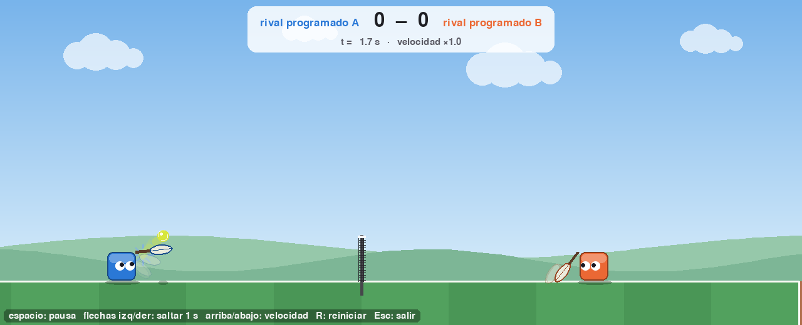
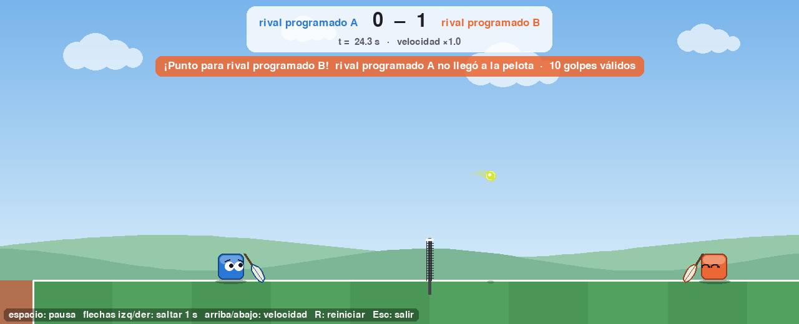

# Capítulo 2 · Grabaciones y visor 2D (V1)

> Etiquetas: `fase-1` (primer visor) y `fase-1.2` (visor nuevo, con ojos) · V1 se hizo junto con F1 · Archivos: `grabar.py` (de F0),
> `ver2d.py`, `partido.py --grabar`, `tests/test_visor.py`

## 2.1 Dónde estamos

El capítulo 1 dejó un juego que funciona, pero solo lo vemos como números:
"gana el jugador 1, motivo doble_bote". Para depurar la física, y más adelante
para descubrir qué estrategias inventa la evolución, hay que **ver** los
partidos.

La tentación sería dibujar mientras se simula, pero eso tiene dos problemas:

1. **Velocidad.** Dibujar 60 cuadros por segundo obliga a simular a velocidad
   real. Sin dibujar, un partido se simula 300 veces más rápido (capítulo 1).
2. **Paralelismo.** El entrenamiento corre en varios procesos a la vez
   (`multiprocessing`); ninguno puede abrir una ventana.

La solución es la misma que usa la televisión con la repetición de una jugada:
**grabar ahora, mirar después**.

## 2.2 Teoría: separar simulación y presentación

```
partido.py ──(si se pide)──► grabación.json ──► ver2d.py (pygame)
                                            └──► ver3d.py (Ursina, capítulo 9)
```

La grabación es un archivo JSON con:

- `cancha`: las medidas de la cancha **copiadas** del `config.py` de ese momento.
  Si mañana cambiamos el ancho de la raqueta, las grabaciones viejas se siguen
  dibujando bien.
- `columnas` y `cuadros`: una "foto" por paso de física. Cada cuadro es una
  lista de 13 números (tiempo, pelota, y para cada jugador: cubo, centro de la
  raqueta y su ángulo). Los nombres van **una sola vez** en `columnas`: repetirlos
  en cada cuadro haría el archivo varias veces más grande.
- `eventos`: los mismos eventos del árbitro. El visor calcula el marcador a
  partir de ellos.
- `version`: si el formato cambia de forma incompatible, se sube el número y
  `cargar_grabacion` rechaza los archivos viejos en vez de dibujar basura.

El visor **no importa la física**: solo lee el archivo. Por eso puede abrir
una grabación hecha con otra versión del código, en otra computadora.

### Del mundo a la pantalla

El mundo tiene `y` hacia arriba; la pantalla, hacia abajo, con el (0, 0) en la
esquina superior izquierda. `Camara.punto` hace la conversión:

```
x_pantalla = (x − x_min) · escala
y_pantalla = y_suelo_en_pantalla − y · escala
```

La raqueta se guarda como **centro + ángulo**. Para dibujarla se calculan sus
cuatro esquinas girando el rectángulo (`esquinas_raqueta`), con la rotación de
siempre: `(dx·cos θ − dy·sen θ, dx·sen θ + dy·cos θ)`.

## 2.3 Cómo está construido

| Pieza | Qué hace |
|---|---|
| `partido.jugar_partido(..., grabacion=g)` | Llena la grabación cuadro a cuadro y le copia los eventos al final |
| `python partido.py --grabar RUTA` | Juega un partido entre rivales programados y lo guarda |
| `ver2d.reproducir` | Ventana con controles (pausa, velocidad, saltar) |
| `ver2d.guardar_captura` | Dibuja un instante en un PNG sin abrir ventana (útil en servidores y para el libro) |
| `ver2d.marcador_hasta` | Cuenta los puntos hasta el instante t leyendo los eventos |

Los colores de los jugadores (azul a la izquierda, naranja a la derecha) son
los mismos en el visor y en las figuras del libro, para que siempre se sepa
quién es quién.

### El diseño visual

El visor está pensado también para la feria, así que además de mostrar lo que
pasa intenta que se vea bien. **Nada de esto cambia el juego**: todo se calcula
leyendo la grabación en el instante `t`.

| Detalle | Cómo se calcula |
|---|---|
| **Ojos que siguen a la pelota** | Del ojo a la pelota hay un vector; se divide por su largo (se **normaliza**, queda de largo 1) y se multiplica por lo que la pupila puede moverse sin salirse del ojo |
| **Gestos** | Si el último evento `punto` ocurrió hace menos de 1,6 s, el ganador cierra los ojos sonriendo (^ ^) y el perdedor baja las cejas |
| **Parpadeo** | Cada jugador parpadea con su propio ritmo: `(t + desfase) mod periodo < 0,12 s` |
| **Cámara que sigue la acción** | Para cada cuadro se encuadra a los dos jugadores y la pelota; el encuadre se **suaviza con un promedio móvil** de 91 cuadros (±0,75 s) para que no tiemble |
| **Estela de la pelota** y **raquetas fantasma** | Se dibujan las posiciones de los cuadros anteriores con transparencia; las raquetas fantasma aparecen solo si la raqueta giró rápido (un golpe) |
| **Anillo al botar** y **destello al golpear** | Se buscan los eventos `bote` y `golpe` de los últimos instantes y se dibujan más grandes y transparentes a medida que pasa el tiempo |
| **Sombras** | Más chicas y claras cuanto más alto está el objeto |
| **Marcador y avisos** | Se cuentan los eventos `punto`; el aviso traduce el motivo ("no llegó a la pelota", "la tiró fuera"...) |

Dibujar un cuadro tarda unos 2 ms, así que el visor puede ir a 60 cuadros por
segundo con margen: el cielo, las nubes y las colinas se pintan **una sola
vez** al abrir la grabación, y en cada cuadro solo se dibuja lo que se mueve.

## 2.4 Diario de decisiones

- **60 cuadros por segundo** (`PASOS_POR_CUADRO = 1`): una grabación de 6
  puntos pesa unos 300 KB. Es poco, y permite cámara lenta fluida en el 3D.
- **Sombra bajo la pelota:** en 2D sobra, pero ayuda a leer la altura de un
  vistazo y es la misma idea que usará el visor 3D.
- **`pygame.display.init()` en lugar de `pygame.init()`:** `init()` también
  enciende el sonido, que no usamos y en algunas computadoras imprime avisos.
- **Cámara que sigue en lugar de cámara fija:** con toda la cancha a la vista
  (2080 unidades de ancho, contando el espacio detrás del fondo), un cubo medía
  25 píxeles y los ojos casi no se veían. Siguiendo la acción mide entre 38 y 46.
- **Solo ojos:** probamos con boca y mejillas, pero los ojos solos se ven más
  limpios y alcanzan para mostrar hacia dónde mira el jugador y cómo le fue.
- **Prueba del visor** (`tests/test_visor.py`): saca capturas sin ventana en
  varios instantes y revisa los gestos y que la cámara siempre encuadre a los
  dos jugadores. Si alguien cambia el formato de grabación y rompe el visor, se
  entera antes de la feria.

## 2.5 Pruébalo tú

```bash
python partido.py --semilla 3 --grabar grabaciones/demo.json
python ver2d.py grabaciones/demo.json
#   espacio = pausa · flechas izq/der = saltar 1 s · arriba/abajo = velocidad · R = reiniciar · Esc = salir
python ver2d.py grabaciones/demo.json --captura grabaciones/cuadro.png --t 1.7
```



*Figura 2.1. El visor en t = 1,7 s de la semilla 3: el jugador izquierdo
acaba de golpear (se ven las raquetas fantasma del golpe y el destello) y la
pelota sale hacia la red. Los dos miran la pelota.*



*Figura 2.2. Justo después de un punto: el ganador (naranja) cierra los ojos
sonriendo, el perdedor (azul) baja las cejas, y el aviso explica qué pasó.*

Experimentos:

1. Abre `grabaciones/demo.json` con un editor de texto y busca `"columnas"`.
   ¿Puedes encontrar a mano la posición de la pelota en el cuadro 100?
2. Pon `PASOS_POR_CUADRO = 2` en `config.py` y graba de nuevo. ¿Cuánto pesa el
   archivo? ¿Se nota en el visor?
3. Graba un partido con `SUBPASOS = 1` y la velocidad máxima de la pelota en
   3000, y búscalo en cámara lenta (flecha abajo): ¿ves alguna pelota atravesando la raqueta?
4. En `ver2d.py`, cambia `SUAVIZADO_CAMARA` a 0 y mira un peloteo: ¿por qué
   marea? Después prueba con 200: ¿qué se pierde?

## 2.6 Criterios de aceptación (V1)

| Criterio | Resultado |
|---|---|
| Se graba un partido | `python partido.py --grabar ...` y `test_grabacion_tiene_cuadros_y_los_mismos_eventos` |
| Se reproduce un partido | `python ver2d.py ...` (ventana) y `--captura` (imagen) |

## 2.7 Puente al capítulo 3

Ahora podemos ver lo que pasa. Lo que todavía no tenemos es un jugador que
**aprenda**. El rival programado es puro conocimiento humano: le escribimos el
tiro parabólico. El siguiente paso es reemplazar esas reglas escritas a mano
por un cerebro artificial con números ajustables, y encontrar esos números por
evolución. Antes de mezclarlo con el tenis, el capítulo 3 explica desde cero
qué es una red neuronal, con un ejercicio pequeño y sin física (fase F2a).

## 2.8 Para estudiar más

- pygame, primeros pasos: https://www.pygame.org/docs/tut/PygameIntro.html
- Rotación de un punto en 2D: https://es.wikipedia.org/wiki/Matriz_de_rotaci%C3%B3n
- Vectores y normalización: *The Nature of Code*, cap. 1 — https://natureofcode.com/vectors/
- Promedio móvil (suavizado): https://es.wikipedia.org/wiki/Media_m%C3%B3vil
- JSON: https://docs.python.org/es/3/library/json.html
