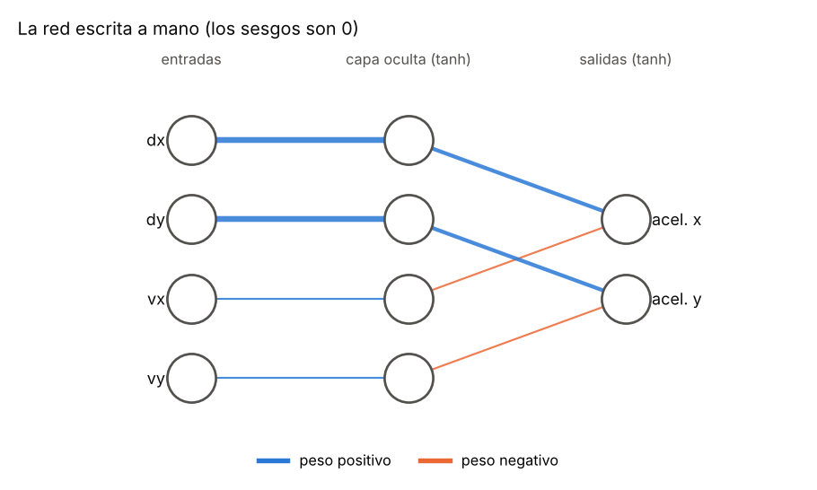
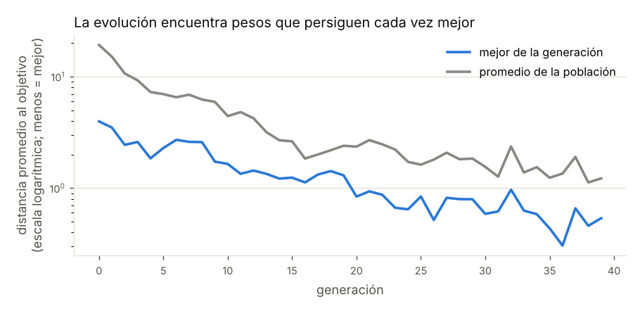
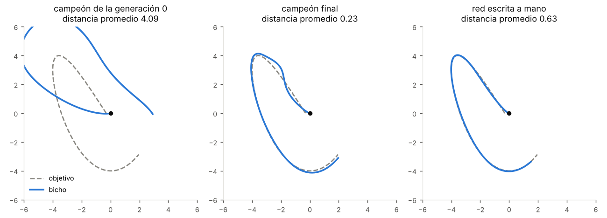
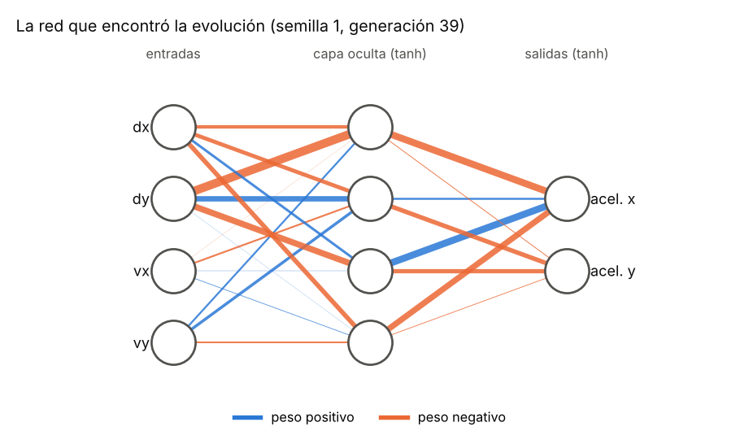

# Capítulo 3 · Qué es una red neuronal (F2a)

> Etiqueta: `fase-2a` · Archivos: `ejercicios/seguir_punto.py`,
> `tests/test_seguir_punto.py`, `docs/libro/figuras/figuras_cap03.py`

## 3.1 Dónde estamos

El rival programado del capítulo 1 juega bien porque **nosotros** le
escribimos las ecuaciones del tiro parabólico. La pregunta del proyecto es
otra: ¿puede un jugador aprender a jugar **sin que nadie le diga cómo**?

Para eso le hace falta un "cerebro" con perillas ajustables (una red neuronal)
y alguien que mueva esas perillas hasta que juegue bien (un algoritmo
genético). Juntar las dos cosas se llama **neuroevolución**.

Antes de meterlas en el tenis, donde cualquier error se confunde con mil
cosas más, las probamos en un problema de juguete: un punto (el "bicho")
tiene que **perseguir a otro punto** que se mueve. Si no aprende esto, no va a
aprender tenis. Es la fase F2a del plan.

## 3.2 Teoría

### 3.2.1 Una neurona

Una neurona artificial es una cuenta muy simple:

```
salida = tanh( w₁·x₁ + w₂·x₂ + ... + wₙ·xₙ + b )
```

- `x₁ ... xₙ` son las **entradas** (números).
- `w₁ ... wₙ` son los **pesos**: cuánto le importa cada entrada a esta neurona.
  Un peso grande y positivo dice "si esta entrada sube, yo subo mucho"; uno
  negativo, "si sube, yo bajo"; uno cerca de 0, "no me importa".
- `b` es el **sesgo**: una tendencia propia, que actúa aunque las entradas sean 0.
- `tanh` es la **función de activación**: "aplasta" cualquier número al rango
  de −1 a 1.

En código es esto (`ejercicios/seguir_punto.py`, función `neurona`):

```python
suma = sesgo
for w, x in zip(pesos, entradas):
    suma += w * x
return math.tanh(suma)
```

Ejemplo a mano: pesos `0,5` y `−1`, entradas `1` y `2`, sesgo `0,25`:
`0,5·1 + (−1)·2 + 0,25 = −1,25`, y `tanh(−1,25) ≈ −0,848`. Esa es exactamente
la primera prueba de `tests/test_seguir_punto.py`.

### 3.2.2 ¿Por qué tanh?

```
tanh(x):   −3 → −0,995    −1 → −0,76    0 → 0    1 → 0,76    3 → 0,995
```

Tres razones:

1. **Acota la salida** entre −1 y 1, el mismo rango que las acciones del
   juego (`Accion.mover`, por ejemplo). La red nunca puede pedir "acelerar a
   un millón".
2. **No es una recta.** Si cada neurona solo sumara, una red de muchas
   neuronas sería equivalente a una sola suma: no podría representar nada más
   complicado que una recta. La curva de `tanh` es lo que permite que la red
   combine las cosas de formas más ricas.
3. **Es suave:** un cambio chico en un peso da un cambio chico en la salida.
   Eso, como vimos con el golpe en el capítulo 1, es lo que hace posible
   mejorar de a poco.

### 3.2.3 Capas y propagación hacia adelante

Una neurona sola sabe poco. Se ponen varias en **capas**: todas las neuronas
de una capa reciben las mismas entradas, cada una con sus propios pesos. La
salida de una capa es la entrada de la siguiente:

```
entradas (4)  ──►  capa oculta (4 neuronas)  ──►  capa de salida (2 neuronas)
 dx, dy, vx, vy                                      aceleración x, aceleración y
```

Calcular la salida a partir de las entradas, capa por capa, se llama
**propagación hacia adelante**. Es lo único que hace la red cuando "piensa":
no hay nada más.

La capa del medio se llama **oculta** porque nadie le dice qué tiene que
calcular: solo se ven las entradas y las salidas. La evolución decide qué
representa cada neurona oculta.

### 3.2.4 El genoma: la red como una lista de números

Todos los pesos y sesgos, uno detrás de otro, forman una lista. Esa lista es
el **genoma** del individuo:

```
[ pesos oculta 0 (4) | sesgo | pesos oculta 1 (4) | sesgo | ... | pesos salida 1 (4) | sesgo ]
   4 ocultas × (4 + 1) = 20 números    +    2 salidas × (4 + 1) = 10 números    =  30
```

Dos redes con la misma forma solo se diferencian en esos 30 números. Encontrar
una red buena es **encontrar 30 números buenos**. El orden (los pesos de cada
neurona juntos) no es casual: en el capítulo 4 el cruce va a heredar
neuronas completas.

### 3.2.5 Normalizar las entradas

Si el objetivo está a 4 unidades y la velocidad es 0,3, la red recibiría
números de tamaños muy distintos, y los pesos tendrían que compensarlo. Por
eso cada entrada se divide por una escala y se recorta a [−1, 1]
(`percibir`): "a 5 unidades o más" se ve como 1. En el tenis esto lo hará
`percepcion.py` (R2), como ya decía la interfaz del capítulo 0.

### 3.2.6 Cómo se encuentran los pesos: el algoritmo genético

Hay dos grandes familias de métodos:

- **Retropropagación** (*backpropagation*): calcula en qué dirección mover cada
  peso para reducir un error. Es lo que usan casi todas las redes modernas,
  pero necesita saber **cuál era la respuesta correcta** en cada momento.
- **Neuroevolución**: prueba muchas redes, se queda con las mejores y las
  varía. Solo necesita un número al final, la **aptitud**, que diga qué tan bien
  le fue a cada una.

En el tenis nadie sabe cuál era "el movimiento correcto" en cada instante:
solo sabemos al final si se ganó o se peloteó. Por eso usamos neuroevolución,
como en las criaturas.

El algoritmo genético, en cinco pasos:

```
1. Crear una POBLACIÓN de 40 genomas al azar.
2. EVALUAR: cada uno juega y recibe su aptitud.
3. SELECCIONAR padres: torneos de 3 (gana el de mejor aptitud).
4. VARIAR: cada hijo es una copia del padre con MUTACIÓN
   (a cada peso se le suma un número al azar, con desviación σ = 0,3).
   Los 2 mejores (ELITISMO) pasan sin cambios.
5. Repetir desde 2 con la nueva población.
```

Dos detalles importantes:

- **Equidad:** en cada generación, todos los individuos persiguen **los mismos**
  movimientos del objetivo. Si a uno le tocara uno fácil y a otro uno difícil,
  la comparación no sería justa.
- **No memorizar:** los movimientos cambian de una generación a otra. Si fueran
  siempre los mismos, la evolución podría encontrar una red que solo sirve
  para ese recorrido. Por eso la comparación final se hace con 20 recorridos
  que **nunca vio** (`comparar`).

## 3.3 Cómo está construido

`ejercicios/seguir_punto.py` tiene cuatro partes, en el orden en que se leen:

| Parte | Funciones | Qué hace |
|---|---|---|
| 1. La red | `neurona`, `capa`, `propagar`, `tamano_genoma` | La red 4-4-2 con tanh |
| 2. El mundo | `movimiento_objetivo`, `percibir`, `simular`, `aptitud` | El objetivo recorre una curva de Lissajous; el bicho acelera, tiene rozamiento; aptitud = −distancia promedio |
| 3. La red a mano | `red_a_mano` | Pesos elegidos por nosotros, para entender qué significan |
| 4. El algoritmo genético | `torneo`, `mutar`, `siguiente_generacion`, `evolucionar` | Población de 40, 40 generaciones |

Los parámetros están al principio del archivo y no en `config.py`, porque el
ejercicio no es parte del experimento.

## 3.4 La red escrita a mano: qué significan los pesos

Antes de dejar que la evolución busque, conviene hacer el trabajo nosotros
una vez. ¿Qué pesos persiguen bien al objetivo? Una idea razonable:

- "acelera hacia donde está el objetivo": la aceleración x depende de `dx`
  con peso positivo;
- "pero frena si ya vas rápido": depende de `vx` con peso **negativo**.

Es la misma idea que el motor de la raqueta (control proporcional, capítulo 1)
más un freno. `red_a_mano` lo arma con la capa oculta haciendo de "copia":



*Figura 3.1. La red escrita a mano. El grosor de cada línea es el tamaño del
peso; azul es positivo y naranja, negativo. Los pesos que valen 0 no se dibujan.*

Propagación hacia adelante, a mano, con `dx = 0,4`, `dy = −0,2`, `vx = 0,1`, `vy = 0`:

| Neurona | Suma | tanh |
|---|---|---|
| oculta 0 | 3 · 0,4 = 1,2 | 0,834 |
| oculta 1 | 3 · (−0,2) = −0,6 | −0,537 |
| oculta 2 | 1 · 0,1 = 0,1 | 0,100 |
| oculta 3 | 0 | 0 |
| **acel. x** | 2 · 0,834 − 1 · 0,100 = 1,568 | **0,917** |
| **acel. y** | 2 · (−0,537) − 1 · 0 = −1,074 | **−0,791** |

El objetivo está a la derecha y abajo, así que el bicho acelera fuerte hacia la
derecha y hacia abajo, un poco menos en x porque ya se mueve en esa dirección.
Puedes comprobarlo:
`python -c "from ejercicios.seguir_punto import *; print(propagar(red_a_mano(), [0.4, -0.2, 0.1, 0.0]))"`.

## 3.5 Lo que encontró la evolución

```
$ python ejercicios/seguir_punto.py
Red de 4 entradas, 4 ocultas y 2 salidas: 30 números en el genoma.

generación   mejor distancia   distancia promedio
        0              3.97                19.30
        5              2.29                 6.98
       10              1.65                 4.43
       20              0.84                 2.36
       30              0.59                 1.55
       39              0.54                 1.22

Distancia promedio en 20 recorridos nuevos (más chica = mejor):
  red al azar          21.37
  campeón generación 0  4.30
  campeón final         0.54
  red escrita a mano    0.98
```



*Figura 3.2. Distancia promedio al objetivo del mejor individuo y del
promedio de la población, por generación (escala logarítmica). La curva del
mejor sube y baja un poco porque cada generación persigue recorridos distintos:
algunos son más difíciles.*



*Figura 3.3. El mismo recorrido del objetivo (gris) perseguido por tres redes
(azul). El campeón de la generación 0 se escapa; el campeón final y la red a
mano lo siguen de cerca.*

Tres cosas para notar:

1. **El campeón de la generación 0 ya es mejor que una red al azar** (4,3 frente
   a 21). Entre 40 redes al azar, alguna persigue "más o menos". La evolución
   parte de ahí.
2. **La evolución supera a nuestra red a mano** (0,54 frente a 0,98). No le
   dijimos cómo perseguir: encontró sola una forma mejor.
3. **Pero no sabemos por qué funciona:**



*Figura 3.4. La red que encontró la evolución. Compárala con la figura 3.1.*

Nuestra red se entiende de un vistazo; la evolucionada es un enredo de pesos
positivos y negativos que, juntos, funcionan. Esto es típico de la
neuroevolución, y es una de las razones del proyecto: **no vamos a poder leer
la estrategia en los pesos**. Por eso el experimento mide comportamientos
(métricas, capítulo 8) y los mira en el visor, en lugar de abrir la red.

## 3.6 Diario de decisiones

Medimos variantes con 5 semillas cada una (distancia final en recorridos
nuevos: promedio, y entre paréntesis la mejor y la peor semilla):

| Variante | Distancia final |
|---|---|
| **Base: 4 ocultas, σ = 0,3, elitismo 2** | **0,57** (0,46 – 0,77) |
| 1 neurona oculta | 3,08 (2,70 – 4,00) |
| 2 neuronas ocultas | 0,61 (0,51 – 0,72) |
| 8 neuronas ocultas | 0,69 (0,52 – 0,90) |
| σ = 0,05 (mutaciones chicas) | 1,77 (0,73 – 2,59) |
| σ = 1,0 (mutaciones grandes) | 0,85 (0,53 – 1,19) |
| sin elitismo | 0,76 (0,62 – 0,93) |

Qué enseña cada fila:

- **Con 1 neurona oculta no alcanza.** Todo lo que sale de la red pasa por un
  solo número, y con un solo número no se puede decir a la vez "ve a la
  derecha" y "ve hacia abajo". Con 2 ya funciona. Es la idea de **capacidad**:
  una red demasiado chica no puede representar la solución.
- **Más neuronas no siempre es mejor.** Con 8 hay 58 números que ajustar en
  lugar de 30, y en 40 generaciones la evolución no alcanza a afinarlos todos.
  Para el tenis el plan propone 8 ocultas y ~140 números: va a necesitar más
  generaciones.
- **El tamaño de la mutación importa.** Con σ muy chico, la evolución avanza a
  pasitos y en 40 generaciones no llega. Con σ muy grande, cada hijo es casi
  una red nueva al azar y se pierde lo aprendido. El plan propone σ entre 0,1
  y 0,2 para el tenis, porque ahí hay muchos más pesos.
- **El elitismo ayuda un poco:** sin él, a veces el mejor de una generación no
  deja copia exacta y se pierde.

## 3.7 Pruébalo tú

```bash
git checkout fase-2a
python ejercicios/seguir_punto.py
python ejercicios/seguir_punto.py --semilla 7 --generaciones 80
pytest tests/test_seguir_punto.py -v
python docs/libro/figuras/figuras_cap03.py     # vuelve a dibujar las figuras
```

Experimentos (cambia la constante al principio de `ejercicios/seguir_punto.py`):

1. **Tus propios pesos.** En `red_a_mano`, cambia el freno (`-1.0`) por `0.0`:
   ¿qué le pasa al bicho? ¿Y con `-3.0`? Mide con `comparar(red_a_mano())`.
2. **Capacidad.** Pon `OCULTAS = 1`. ¿Puedes explicar con tus palabras por qué
   no aprende? (Pista: mira la figura 3.1 y piensa qué tendría que pasar por
   esa única neurona.)
3. **Mutación.** Prueba `SIGMA = 0.05` y `SIGMA = 2.0` con la misma semilla.
4. **Memorizar.** En `evolucionar`, saca la línea `movimientos = ...` fuera del
   bucle (que siempre persiga el mismo recorrido). La aptitud en el
   entrenamiento, ¿mejora más o menos? ¿Y la distancia en recorridos nuevos?
5. **Sin tanh.** En `neurona`, devuelve `suma` en lugar de `math.tanh(suma)`.
   ¿Qué pasa con la red al azar? (Pista: ya no hay tope para la aceleración.)

## 3.8 Preguntas para comprobar (criterio de F2a)

El criterio de aceptación de F2a es que quien tome el rol R2 pueda explicar
estas ideas con sus palabras. Intenta responder antes de abrir cada respuesta.

<details><summary>1. ¿Qué es un peso?</summary>

Un número que dice cuánto influye una entrada en una neurona, y en qué
sentido. Positivo: la entrada empuja la salida hacia arriba. Negativo, hacia
abajo. Cerca de 0: casi no influye.
</details>

<details><summary>2. ¿Qué hace una neurona, paso a paso?</summary>

Multiplica cada entrada por su peso, suma todo, le suma el sesgo y pasa el
resultado por tanh, que lo deja entre −1 y 1.
</details>

<details><summary>3. ¿Qué es la propagación hacia adelante?</summary>

Calcular la salida de la red a partir de sus entradas, capa por capa: las
salidas de una capa son las entradas de la siguiente.
</details>

<details><summary>4. ¿Qué es el genoma y por qué tiene 30 números?</summary>

Es la lista de todos los pesos y sesgos de la red. Cada una de las 4 neuronas
ocultas tiene 4 pesos y 1 sesgo (20 números), y cada una de las 2 de salida,
4 pesos y 1 sesgo (10 números).
</details>

<details><summary>5. ¿Por qué usamos un algoritmo genético y no retropropagación?</summary>

Porque la retropropagación necesita saber la respuesta correcta en cada
momento, y en el tenis solo sabemos al final si al jugador le fue bien (la
aptitud). El algoritmo genético solo necesita ese número.
</details>

<details><summary>6. ¿Por qué todos los individuos de una generación persiguen el mismo recorrido, y por qué cambia entre generaciones?</summary>

Lo primero, para que la comparación sea justa. Lo segundo, para que la
evolución no encuentre una red que solo sirve para un recorrido memorizado.
</details>

## 3.9 Criterios de aceptación

| Criterio del plan | Cómo se comprueba | Resultado |
|---|---|---|
| El ejercicio aprende | `test_la_evolucion_mejora` y `python ejercicios/seguir_punto.py` | La distancia baja de 4,3 a 0,54 (semilla 1); con 5 semillas, 0,57 en promedio |
| El integrante explica peso, neurona y propagación | Preguntas de la sección 3.8 | **Lo comprueba el equipo** |

## 3.10 Puente al capítulo 4

El bicho aprendió a perseguir un punto. Para el tenis hay que cambiar tres
cosas, y son el capítulo 4 (fase F2b):

1. **La red** sale del ejercicio y pasa a `red.py`, con las 12 entradas de
   `Percepcion` y las 4 salidas de `Accion`, más grande (8 ocultas, ~140 números).
   El plan pide medir si es más rápida en Python puro o con NumPy.
2. **El algoritmo genético** pasa a `genetico.py` y gana el **cruce por
   neurona** (un hijo hereda neuronas completas de cada padre), con guardado y
   reanudación.
3. **El problema** pasa a ser la etapa 1 del currículo: devolver las pelotas
   de un lanzapelotas. Ahí aparece la gran dificultad que el bicho no tenía:
   al principio **nadie toca la pelota**, así que todas las aptitudes valen
   casi lo mismo y la evolución no tiene a quién elegir.

## 3.11 Para estudiar más

- 3Blue1Brown, *Neural Networks* (YouTube), capítulos 1 y 2: qué es una neurona
  y una red, muy visual. Hay subtítulos en español.
- *The Nature of Code*, cap. 10 (redes neuronales) — https://natureofcode.com/neural-networks/
- *The Nature of Code*, cap. 11 (neuroevolución) — https://natureofcode.com/neuroevolution/
- *The Nature of Code*, cap. 9 (algoritmos genéticos) — https://natureofcode.com/genetic-algorithms/
- Función tangente hiperbólica — https://es.wikipedia.org/wiki/Tangente_hiperb%C3%B3lica
- Curvas de Lissajous (el recorrido del objetivo) — https://es.wikipedia.org/wiki/Curva_de_Lissajous
