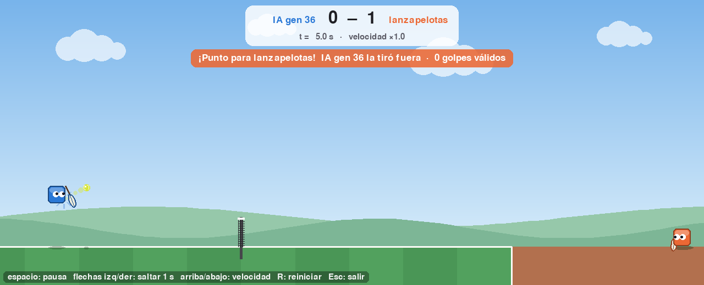

# Capítulo 4 · Neuroevolución y etapa 1: aprender a devolver (F2b)

> Etiqueta: `fase-2b` · Archivos nuevos: `red.py`, `percepcion.py`, `genetico.py`,
> `aptitud.py`, `entrenar.py`, y en `rivales.py` el lanzapelotas.
> Pruebas: `tests/test_red.py`, `test_genetico.py`, `test_aptitud.py`, `test_entrenar.py`

## 4.1 Dónde estamos

En el capítulo 3 una red de 30 números aprendió a perseguir un punto. Ahora
llevamos esa misma idea al tenis. Cambian tres cosas:

- la red es más grande (156 números) y controla un jugador de verdad;
- el algoritmo genético gana el **cruce** y el **guardado**, porque un
  entrenamiento ya no dura 3 segundos;
- y el problema es mucho más difícil: **al principio nadie toca la pelota**.

Por eso el plan no tira a los jugadores directo a jugar contra otro: los
entrena por **etapas** (un currículo, como en la escuela). La etapa 1 es la
más simple posible: una máquina lanza pelotas a su campo, y el jugador tiene
que devolverlas.

## 4.2 Teoría

### 4.2.1 De la red de juguete a la del tenis

| | Ejercicio (cap. 3) | Tenis |
|---|---|---|
| Entradas | 4 (dx, dy, vx, vy) | 14 (`percepcion.py`) |
| Ocultas | 4 | 8 (`config.OCULTAS`) |
| Salidas | 2 (aceleración) | 4: mover, saltar, ángulo de raqueta, golpe |
| Números en el genoma | 30 | (14 + 1) · 8 + (8 + 1) · 4 = **156** |

Las 4 salidas, todas tanh, se traducen a una `Accion` (`red.salidas_a_accion`):

- `mover` y `ángulo` pasan tal cual (ya van de −1 a 1);
- `saltar` es verdadero si la salida es mayor que 0;
- `golpe` necesita superar un **umbral** (`UMBRAL_GOLPE = 0,3`); si lo supera,
  la fuerza va de casi 0 (justo encima del umbral) a 1. Sin umbral, una red al
  azar golpearía la mitad del tiempo y estaría siempre en recarga.

### 4.2.2 Entradas derivadas

La `Percepcion` trae 12 valores (capítulo 0). `percepcion.py` los normaliza
(capítulo 3) y agrega **dos más**: dónde está la pelota *respecto de la
raqueta* (`dx`, `dy`). No es información nueva, porque la red podría
calcularla restando "pelota x" menos "propio x". Pero una red con pesos al
azar tarda mucho en "descubrir" justo esa resta, y es lo primero que
necesita para golpear. Dársela hecha es como darle a un estudiante la fórmula
en lugar de pedirle que la deduzca: no cambia lo que puede aprender, sí lo
rápido que lo aprende.

### 4.2.3 El cruce, y por qué "por neurona"

En el capítulo 3 cada hijo era una copia mutada de **un** padre. El cruce
permite que un hijo combine lo bueno de **dos** padres. Hay dos formas:

- **Cruce uniforme:** cada uno de los 156 pesos viene, al azar, de uno u otro
  padre.
- **Cruce por neurona:** cada neurona viene **completa** (sus 15 pesos de
  entrada y su sesgo) de uno u otro padre.

¿Por qué importa? Los pesos de una neurona trabajan **en equipo**: si la
neurona 3 del padre A aprendió a detectar "la pelota está delante de mí y
bajando", eso depende de la combinación de sus 15 pesos. Si el hijo hereda 7
pesos de esa neurona y 8 de la neurona 3 del padre B, que quizás aprendió otra
cosa, lo más probable es que la neurona resultante no sirva para nada. Con el
cruce por neurona, la neurona 3 del hijo detecta exactamente lo mismo que la
de su padre.

Aun así, el cruce por neurona tiene un límite conocido: dos padres pueden haber
aprendido lo mismo en neuronas **distintas** (A en la neurona 3, B en la 5), y
entonces el hijo puede heredar esa habilidad dos veces o ninguna. Es el
"problema de las convenciones en competencia" de la neuroevolución. Por eso el
plan pide **comparar** con el cruce uniforme y con no cruzar (sección 4.5).

En el código: `genetico.cruce_por_neurona` usa `red.bloques_neuronas()`, que
sabe dónde empieza y termina cada neurona dentro del genoma. Para eso el
genoma está ordenado **por neurona** desde el capítulo 3.

### 4.2.4 Recorte suave

La mutación suma números al azar, así que sin control algún peso podría
crecer sin límite. En vez de cortarlo en seco en ±5, usamos
`5 · tanh(w / 5)`: un peso de 0,1 queda en 0,1, uno de 3 queda en 2,7 y uno de
50 queda en 5. Los pesos chicos casi no se tocan y los grandes se frenan de a
poco.

### 4.2.5 El problema del arranque y la aptitud "por escalones"

Con pesos al azar, casi ningún jugador toca la pelota. Si la aptitud fuera
solo "pelotas devueltas bien", **todos tendrían 0**, el torneo elegiría al
azar y la evolución no avanzaría: no hay a quién premiar. Es el **problema
del arranque** (*bootstrap problem*).

La solución del plan es una aptitud con **escalones**, cada uno más fácil de
alcanzar que el siguiente:

| Logro con una pelota | Premio |
|---|---|
| no la toca, pero se acerca | hasta +0,5 (según la distancia mínima) |
| la toca | +1 |
| ... y la pasa al otro lado de la red | +3 más |
| ... y bota dentro del campo rival | +5 más (en total, 9) |

Así, en la generación 0, el que se acerca le gana al que se aleja, el que la
toca le gana al que se acerca, y así sucesivamente. A esto se le llama dar
forma a la aptitud (*fitness shaping*).

Hay que diseñarla con cuidado, porque **la evolución explota cualquier hueco**:
si acercarse valiera 2 y tocar valiera 1, la evolución inventaría jugadores
que se pegan a la pelota sin tocarla jamás. Por eso el premio por acercarse
(0,5) es menor que el de tocar (1). Y "tocar" se cuenta **una vez por pelota**,
para que no convenga tocarla muchas veces sin devolverla.

### 4.2.6 Aptitud con ruido

Cada individuo se evalúa con **8 pelotas** por generación (todas iguales para
todos: equidad). Con tan pocas, la suerte pesa: un jugador mediocre puede
tener una buena tanda. Por eso el "mejor" de cada generación sube y baja tanto
en la tabla de la sección 4.5.

Para saber de verdad cuánto mejora, cada 5 generaciones se prueba al campeón
con una **batería fija de 40 pelotas**: siempre las mismas, así que se puede
comparar el campeón de la generación 10 con el de la 30. Y para estar seguros
de que no "aprendió de memoria" esa batería, al final se lo prueba con 200
pelotas que **nunca vio**.

### 4.2.7 Evaluar en paralelo

Cada generación juega 60 × 8 = 480 pelotas. Una computadora con varios
núcleos puede jugar varias a la vez. `multiprocessing.Pool` arranca un proceso
por núcleo y les reparte los individuos (`pool.map`). Dos condiciones:

- la función que se reparte (`entrenar.evaluar_etapa1`) tiene que estar
  definida a nivel de módulo, y lo que recibe (el genoma, una lista de números)
  tiene que poder **copiarse** a otro proceso (eso es "picklable");
- el resultado no puede depender de qué núcleo juega qué. Por eso **el azar no
  se reparte**: cada partido depende solo de su semilla.

En Windows, todo programa que use `multiprocessing` necesita el
`if __name__ == "__main__":` al final, que `entrenar.py` ya tiene.

### 4.2.8 Guardado y reanudación

Después de **cada** generación se guarda todo en `estado.json` (con el
guardado atómico del capítulo 0) y se reescribe `historial.csv`. Si el
entrenamiento se corta, el mismo comando sigue desde la última generación.

Para que reanudar dé **exactamente** el mismo resultado que no cortar, el azar
de cada generación sale de un texto: `random.Random("1-etapa1-gen37")`. Con una
semilla de texto, Python produce siempre la misma secuencia, en cualquier
computadora. Así no hace falta guardar el estado interno del generador.

## 4.3 Cómo está construido

| Archivo | Qué hace |
|---|---|
| `percepcion.py` | `Percepcion` → 14 números entre −1 y 1 (12 normalizados + 2 derivados) |
| `red.py` | `Red` (arma el genoma en neuronas una vez), `salidas_a_accion`, `ControladorRed`; `python red.py --medir` |
| `genetico.py` | Población inicial, torneo, cruce por neurona o uniforme, mutación con recorte suave, elitismo |
| `rivales.py` | `lanzapelotas` (una función de saque) y `ControladorAusente` (se va al fondo) |
| `aptitud.py` | `aptitud_etapa1` a partir de los eventos: escalones y fracción devuelta |
| `entrenar.py` | El bucle de la etapa 1, en paralelo, con guardado, reanudación y prueba del campeón |
| `partido.py` | Nuevo parámetro `receptor_fijo`: el lanzapelotas siempre le lanza al que aprende |

Una generación de la etapa 1:

```
semilla + generación ──► lanzamientos de esta generación (los mismos para todos)
        │
población (60 genomas) ──pool.map──► 60 × jugar_partido(IA, ausente, 8 pelotas del lanzapelotas)
        │                                     │
        │                          aptitud_etapa1(eventos) ──► 60 aptitudes
        │
cada 5 gen: campeón ──► batería fija de 40 pelotas ──► ¿≥ 60 %? ──► termina la etapa
        │
genetico.siguiente_generacion ──► nueva población ──► guardar estado.json + historial.csv
```

## 4.4 Diario de decisiones

### a) ¿Python puro o NumPy? (sección 4 del plan)

`python red.py --medir`:

| Forma | Una propagación |
|---|---|
| Python puro | 8,1 µs |
| NumPy | 4,6 µs |

NumPy es casi el doble de rápido, pero eso no decide la cuestión. Medimos
con un perfilador qué parte de un partido completo se va en la red: **6 %**
(y 4 % en normalizar las entradas). Pasar a NumPy ahorraría como mucho un 3 %
del tiempo total, a cambio de un código menos fácil de leer para quien no
conoce NumPy. **Nos quedamos con Python puro.** La lección sirve para
cualquier optimización: antes de acelerar algo, medir si es lo que de verdad
frena.

### b) Un error del árbitro que encontró el lanzapelotas

Al probar el lanzapelotas con un jugador quieto, salían puntos **anulados**
que no deberían existir. La causa: la pelota botaba bien en el campo del
receptor, seguía de largo y el **segundo** bote caía fuera de la cancha (x < 0).
El árbitro solo revisaba "¿el bote del saque cayó en el campo del receptor?",
y como este no, anulaba el punto. La regla correcta es la misma que después de
un golpe: si ya botó bien una vez, el segundo bote, caiga donde caiga, lo
pierde el que no la devolvió. Se corrigió en `arbitro.py` y se agregaron dos
pruebas. En los partidos de F1 casi no aparecía (las estadísticas no
cambiaron), pero en la etapa 1, donde casi nadie devuelve al principio, habría
convertido muchos fallos en "anulados".

### c) El lanzapelotas apunta con el tiro parabólico

Para que las pelotas boten **donde queremos** (entre 150 y 450 del fondo del
que aprende), el lanzapelotas elige el punto de bote, la altura y el ángulo,
y calcula la rapidez con `rivales.rapidez_para_llegar`, la misma fórmula del
rival programado. La prueba `test_el_lanzapelotas_bota_en_el_campo_del_receptor`
lo verifica en los dos lados.

### d) El rival de la etapa 1 se va

Si el rival se quedara quieto en su lugar, su raqueta podría tocar las
pelotas devueltas, y el árbitro le daría el golpe a él. `ControladorAusente`
se va al fondo de su campo y baja la raqueta.

## 4.5 Resultados

### La primera corrida (semilla 1)

> **Nota.** Esta corrida es de la primera versión de `entrenar.py`, que daba la
> etapa por terminada apenas el campeón cumplía la meta en la batería de
> prueba. En el capítulo 5 descubrimos que eso infla los resultados (la
> "maldición del ganador") y agregamos una batería de validación. Con la regla
> nueva, la misma semilla tarda 150 generaciones en cumplir la meta de verdad
> (sección 5.4).

```
$ python entrenar.py --carpeta resultados/prueba --semilla 1 --procesos 4
gen    mejor  promedio  devueltas(mejor)  prueba campeón  segundos
  0    3.787     0.658               38%             20%       1.5
  5    3.612     1.160               25%              2%       1.5
 10    3.030     1.140               25%             15%       1.4
 15    4.713     1.300               50%             25%       1.6
 20    3.009     1.019               25%             42%       1.6
 25    3.928     1.095               38%             22%       1.6
 30    6.865     1.733               75%             25%       1.8
 35    7.375     1.382               75%             60%       2.0
Etapa 1 terminada en la generación 36: el campeón devuelve bien el 60% de la batería de prueba.
```

- **Tardó 36 generaciones y menos de un minuto** (1,2 a 2 s por generación con 4 procesos).
- En **200 pelotas nuevas**, el campeón devuelve bien entre el 57 % y el 65 %
  (según la tanda): no memorizó la batería de prueba.
- Cortar el entrenamiento en la generación 20 y reanudarlo da **exactamente**
  la misma población y el mismo historial que no cortarlo.



*Figura 4.1. El campeón de la etapa 1 (semilla 1, generación 36) devolviendo una
pelota del lanzapelotas, que está al fondo a la derecha. Fíjate en que está
**en el aire**: salta para golpear la pelota antes de que bote. Nadie le enseñó
a saltar ni a volear; es la primera estrategia que inventó la evolución.*

### Los tipos de cruce

> **Resultados preliminares.** Esta comparación se corrió con la primera
> versión de la regla de la meta (sin validación, ver capítulo 5) y se cortó
> al cambiar la regla, así que está incompleta: falta "sin cruce" y una semilla
> del cruce uniforme. Para repetirla completa con la regla actual (tarda
> alrededor de una hora con 4 procesos):
> `python docs/libro/figuras/medir_etapa1.py --procesos 4`,
> que además dibuja la figura `img/cap04_cruces.png`.

| Cruce | Generaciones hasta la meta, por semilla | Promedio | Devuelve en 200 pelotas nuevas |
|---|---|---|---|
| Por neurona | 36, 91, 11, 41, 16 (semillas 1 a 5) | 39 | 62 % a 76 % |
| Uniforme | 61, 81, 26, 31 (semillas 1 a 4) | 50 | 64 % (semilla 1) |
| Sin cruce | (sin datos) | | |

**¿Hay diferencia?** Con estos datos, **no se puede decir**. El cruce por
neurona tardó menos en promedio (39 frente a 50 generaciones), pero mira cuánto
cambia de una semilla a otra: de 11 a 91 generaciones con el mismo método. La
prueba U de Mann-Whitney (capítulo 8) da un valor p de 0,73: una diferencia así
aparece por pura casualidad la mayoría de las veces. Para comparar métodos con
tanta variación entre semillas hacen falta muchas más semillas. Por ahora
dejamos el cruce por neurona, que es el del plan y no salió peor.

Esta es una lección importante para todo el proyecto: **una sola corrida no
prueba nada**. Por eso el experimento principal usa varias semillas (5 a 10)
por tratamiento.

## 4.6 Pruébalo tú

```bash
git checkout fase-2b
pytest
python red.py --medir
python entrenar.py --carpeta resultados/mi_prueba --semilla 1
#   (córtalo con Ctrl+C a la mitad y vuelve a correrlo: sigue donde quedó)
python entrenar.py --carpeta resultados/mi_prueba --grabar-campeon
python ver2d.py resultados/mi_prueba/campeon_etapa1.json
```

`resultados/` no se sube a git (está en `.gitignore`): cada uno tiene los suyos.

Experimentos (en `config.py`; usa una carpeta nueva para cada uno):

1. **Sin escalones.** Pon `PREMIO_TOQUE = 0`, `PREMIO_CRUZA = 0` y
   `PREMIO_CERCANIA = 0` (solo cuenta devolver bien). ¿Cuántas generaciones
   tarda ahora? ¿Llega? Es el problema del arranque de 4.2.5.
2. **Una trampa a propósito.** Pon `PREMIO_CERCANIA = 2.0` (más que tocar).
   Mira al campeón en el visor: ¿qué estrategia encontró?
3. **Menos pelotas.** `LANZAMIENTOS_POR_EVALUACION = 2`: más rápido, pero más
   ruido. ¿Mejora o empeora el resultado final?
4. **Sin entradas derivadas.** En `percepcion.py`, cambia `N_ENTRADAS = 12` y
   borra las dos últimas líneas de `valores`. ¿Se nota?
5. **Ver el paralelismo.** Corre con `--procesos 1` y con `--procesos 4`, y
   compara la columna "segundos".

## 4.7 Criterios de aceptación

| Criterio del plan | Cómo se comprueba | Resultado |
|---|---|---|
| La aptitud de la etapa 1 sube | `historial.csv` | El promedio de la población pasa de ≈ 0,7 a ≈ 1,5–1,9 (y a ≈ 3 en la corrida larga del capítulo 5) |
| El campeón devuelve ≥ 60 % de las pelotas | Batería fija de 40 pelotas; y 200 nuevas | 60 % (semilla 1, gen. 36); 57–65 % en pelotas nuevas. Con la validación del capítulo 5: 60 % y 60 % (gen. 150) |
| Red, percepción con espejo, `genetico.py`, lanzapelotas | `tests/test_red.py`, `test_genetico.py`, `test_entrenar.py` | Pasan |
| Guardado y reanudación | `test_reanudar_da_lo_mismo_que_no_cortar` | Idéntico |
| ¿Python puro o NumPy? | `python red.py --medir` + perfilador | Python puro (la red es el 6 % del tiempo) |

## 4.8 Presupuesto de cómputo

La etapa 1 es **barata**: una pelota que nadie devuelve dura 2 o 3 segundos de
juego. Con 4 procesos, una generación tarda entre 1 y 2 segundos, y la etapa
completa, menos de 5 minutos en el peor caso (150 generaciones). En la laptop
del equipo (10 núcleos) debería tardar menos. Lo caro llegará en las etapas 2
y 3, con partidos de verdad.

## 4.9 Puente al capítulo 5

El jugador ya sabe devolver la pelota, pero solo contra una máquina que le
manda pelotas cómodas y no le devuelve nada. Para **jugar** hay que poder
sostener un peloteo y ganar puntos contra alguien que también devuelve. La
etapa 2 lo enfrenta al rival programado del capítulo 1, con otra aptitud:
puntos ganados + 0,2 × devoluciones válidas. El objetivo de F3: que el
campeón gane al menos el 40 % de los puntos.

## 4.10 Para estudiar más

- Cruce en neuroevolución y el problema de las convenciones en competencia:
  K. Stanley y R. Miikkulainen, "Evolving Neural Networks through Augmenting
  Topologies", *Evolutionary Computation*, 2002, sección 2.2 —
  https://nn.cs.utexas.edu/downloads/papers/stanley.ec02.pdf
- Currículos y dar forma a la aptitud: *The Nature of Code*, cap. 11 —
  https://natureofcode.com/neuroevolution/
- Trampas de la evolución (por qué la aptitud hay que diseñarla con cuidado):
  Lehman et al., "The Surprising Creativity of Digital Evolution", 2018 —
  https://arxiv.org/abs/1803.03453
- `multiprocessing` — https://docs.python.org/es/3/library/multiprocessing.html
- Semillas de texto en `random` — https://docs.python.org/es/3/library/random.html#random.seed
