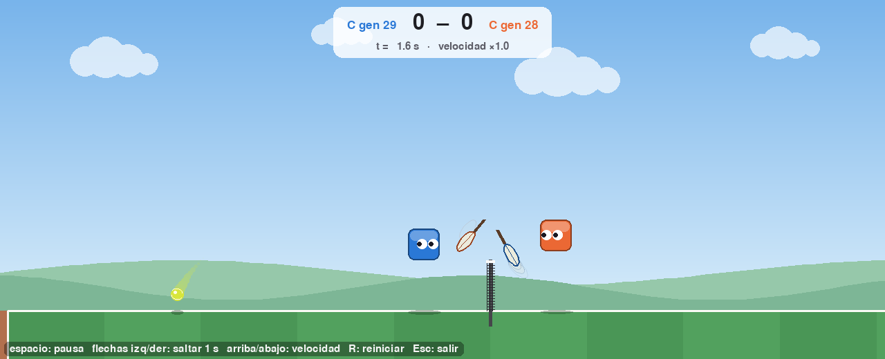

# Capítulo 6 · Etapa 3: coevolución y las aptitudes A, B y C (F4)

> Etiqueta: `fase-4` · Archivos: `entrenar.py` (etapa 3: `entrenar_etapa3`,
> `elegir_rivales`, salón de la fama), `aptitud.py` (`aptitud_A`, `_B`, `_C`),
> `experimentos.py`, `config.py` (etapa 3)

## 6.1 Dónde estamos

Este es el corazón del proyecto. Hasta ahora todos los jugadores aprendieron
lo mismo, de la misma manera. Desde la **población base** (capítulo 5) salen
tres ramas, idénticas en todo menos en **qué se premia**:

| Rama | Aptitud | Pregunta |
|---|---|---|
| A · Ganar | (ganados − perdidos) / jugados | ¿Salen jugadores agresivos? (H1) |
| B · Pelotear | golpes válidos por punto, compartida | ¿Salen colaboradores, aunque nadie les pidió "no ganar"? (H2) |
| C · Precisión | % de golpes profundos válidos − % de golpes que terminan en error | ¿Salen jugadores que arriesgan más? (H3) |

Y ya no hay un rival fijo: cada jugador juega contra **otros jugadores de su
misma rama**. Eso se llama **coevolución**.

## 6.2 Teoría

### 6.2.1 Coevolución: cuando el rival también aprende

En las etapas 1 y 2 el rival era fijo, así que "mejorar" tenía un sentido
claro. En la etapa 3 el rival es la propia población, que también cambia. La
aptitud deja de ser absoluta y pasa a ser **relativa**: ser bueno es ser mejor
que los demás *de ahora*.

Eso puede producir una **carrera armamentista**: A inventa un tiro, B aprende a
devolverlo, A inventa otro... Es lo que se busca, porque así los jugadores
siguen mejorando sin que nadie diseñe rivales cada vez más difíciles. Pero
tiene dos peligros conocidos:

- **Ciclos:** la estrategia X le gana a Y, Y a Z y Z a X (como piedra, papel o
  tijera). La población puede dar vueltas sin mejorar.
- **Olvido:** si nadie en la población usa ya un tiro viejo, nadie necesita
  saber devolverlo, y se olvida. Si reaparece, gana fácil.

Por eso una aptitud que "sube" en la etapa 3 no significa necesariamente que
el jugador mejore, y la que "no sube" no significa que no mejore. En la rama A,
por ejemplo, el promedio de la población siempre ronda 0 o menos: si todos
mejoran igual, se siguen ganando la mitad de los puntos entre ellos. Para medir
el progreso de verdad hace falta un **rival fijo**: la batería de referencia de
las métricas (sección 6.2.4).

### 6.2.2 El salón de la fama

Contra el olvido y los ciclos, el plan usa el **salón de la fama** (Rosin y
Belew, 1997): se guarda al campeón de **cada** generación, y cada individuo
juega también contra campeones viejos elegidos al azar. Así, olvidar cómo
ganarle a una estrategia antigua cuesta aptitud.

En cada generación, cada individuo juega 4 partidos de 6 puntos:

- 2 contra rivales al azar de la población actual (`RIVALES_POBLACION`);
- 2 contra campeones al azar del salón (`RIVALES_SALON`);
- la mitad a la izquierda y la mitad a la derecha (con el marco propio del
  capítulo 0 la red es la misma, pero así no se acostumbra a un solo lado).

Los saques de esos 4 partidos son **los mismos para todos** los individuos de
la generación (equidad).

### 6.2.3 La bifurcación: el control experimental

¿Cómo sabemos que una diferencia entre A y B se debe a la aptitud y no a otra
cosa? Haciendo que **todo lo demás sea igual**:

```
              semilla 1
                  │
     etapas 1 y 2 (una sola vez)
                  │
          población base ───────────┐───────────┐
                  │                 │           │
           rama A (ganar)   rama B (pelotear)  rama C (precisión)
```

Las tres ramas parten de **los mismos 60 jugadores**, con la misma física, la
misma red, el mismo algoritmo genético. Lo único que cambia es la función de
aptitud: es la **variable independiente** del experimento. Esto, además, ahorra
cómputo: las etapas 1 y 2 se entrenan una vez por semilla, no tres.

### 6.2.4 Las tres aptitudes, en detalle

Están en `aptitud.py` y se calculan con los eventos de los 4 partidos del
individuo (sección 7 del plan; **no se cambian sin acuerdo del equipo**).

**A · Ganar.** `(ganados − perdidos) / jugados`. Va de −1 (perdió todos) a 1
(ganó todos). Los puntos anulados no suman ni restan: se sacan del
denominador.

**B · Pelotear.** El promedio de golpes válidos por punto, **sin distinguir
quién los dio**: si un punto tuvo 6 golpes válidos, vale 6 para los dos
jugadores. Es una aptitud **compartida**, y por eso la hipótesis H2 espera
colaboración: a un jugador B le conviene que su rival devuelva bien.

**C · Precisión.** De todos los golpes del jugador: la fracción que fue válida
y botó en el **tercio profundo** del campo rival (a más de 400 unidades de la
red), menos la fracción que terminó en error (fue el último golpe del punto y
el punto lo perdió él por red, fuera o techo).

### 6.2.5 Dos decisiones de interpretación (para que el equipo las confirme)

El plan dice: "Puntos anulados: no suman ni restan en A y C. En B se registran
aparte, para detectar si 'congelar' la pelota se vuelve una trampa". Lo
interpretamos así:

1. **En B, los anulados cuentan.** Un peloteo que llega al tiempo máximo con 10
   golpes válidos es justo lo que B premia; sacarlo del promedio castigaría al
   mejor peloteo posible. La fracción de anulados se guarda aparte en el
   historial (columna `anulados`) para vigilar la trampa.
2. **En C, un jugador que no golpea nunca tiene aptitud 0**, igual que uno que
   golpea mitad bien y mitad mal. Es un posible hueco: si golpear se volviera
   muy arriesgado, la evolución podría preferir "no jugar". Lo vigilamos con
   las métricas (golpes válidos y errores). Si aparece, sería una trampa para
   documentar (hipótesis H4).

## 6.3 Cómo está construido

| Pieza | Qué hace |
|---|---|
| `entrenar.entrenar_etapa3(carpeta, ruta_base, tratamiento, procesos)` | Una rama: parte de `poblacion_base.json` y evoluciona con la aptitud del tratamiento. Reanudable |
| `entrenar.elegir_rivales` | 2 rivales de la población (sin él mismo) + 2 del salón (en la generación 0, de la población) |
| `entrenar.evaluar_etapa3` | Juega los 4 partidos en los dos lados y calcula la aptitud |
| `estado["salon"]` | El campeón de cada generación |
| `estado["metricas"]` | Cada `METRICAS_CADA` (10) generaciones, las métricas del campeón contra la batería de referencia |
| `experimentos.py` | Para cada semilla: currículo una vez, y las tres ramas desde la misma población base |

```bash
python experimentos.py --carpeta resultados/corto --semillas 1 --generaciones 30
```

crea:

```
resultados/corto/semilla_1/curriculo/   (etapas 1 y 2, poblacion_base.json)
resultados/corto/semilla_1/rama_A/      (estado.json, historial.csv)
resultados/corto/semilla_1/rama_B/
resultados/corto/semilla_1/rama_C/
resultados/corto/resumen.json           (lo que lee graficos.py)
```

## 6.4 Resultados de la corrida corta (semilla 1, 30 generaciones por rama)

```bash
python experimentos.py --carpeta resultados/f4 --semillas 1 --generaciones 30 --procesos 4
```

Las tres ramas **terminan sin errores**, y rápido: unos 3 segundos por
generación con 4 procesos (100 segundos por rama). Al principio los partidos
entre jugadores mediocres son cortos, así que esto es mucho menos que el peor
caso estimado en el capítulo 1.

Pero aparecieron dos problemas, y los dos son de los que el plan advertía en
su sección 14 de riesgos.

### a) Las tres ramas empeoran contra el rival de referencia

Métricas del campeón contra la batería de referencia:

| Rama | Métrica | Gen. 0 | Gen. 10 | Gen. 20 |
|---|---|---|---|---|
| A | Puntos ganados | 26 % | 17 % | 4 % |
| B | Golpes válidos por punto | 1,83 | 1,87 | 0,99 |
| C | Puntos ganados | 17 % | 21 % | 5 % |

¿Empeora solo el campeón (que se elige con mucho ruido) o toda la población?
Medimos a 20 individuos de cada población contra el rival de referencia:

| Población | Puntos ganados | Golpes válidos por punto |
|---|---|---|
| Base (antes de la etapa 3) | 26 % | 1,36 |
| Rama A, generación 30 | 18 % | 0,80 |
| Rama B, generación 30 | 16 % | 1,53 |
| Rama C, generación 30 | 16 % | 0,85 |

Empeora **toda** la población. Hay dos explicaciones posibles:

1. **Deriva por ruido.** Cada individuo se evalúa con solo 24 puntos (4
   partidos de 6). Con tan pocos, la selección casi no distingue a los buenos
   de los malos, y la mutación va borrando habilidades que nadie "defiende".
2. **Especialización.** La coevolución los vuelve buenos contra los de su
   población, y malos contra otros estilos.

Para distinguirlas, corrimos la rama A con dos variantes (población de la
generación 30 contra el rival de referencia):

| Variante de la rama A | Puntos ganados | Golpes válidos por punto |
|---|---|---|
| Como está (σ = 0,15; 2 + 2 rivales) | 18 % | 0,80 |
| Mutación más chica (σ = 0,05) | **26 %** | 1,05 |
| El doble de partidos (4 + 4 rivales) | 21 % | **1,34** |

Con menos mutación o con más partidos por evaluación, la población **conserva**
lo aprendido. La causa principal es la deriva por ruido. Hay arreglo sin tocar
el diseño experimental: son parámetros del algoritmo genético, iguales para los
tres tratamientos (variables controladas).

### b) La trampa de C: no jugar



*Figura 6.1. Dos campeones de la rama C (generaciones 28 y 29) jugando entre
sí. La pelota va a botar dos veces en el campo azul, y ninguno de los dos
intenta llegar: en 10 puntos dieron 0,2 golpes por punto, y los 10 puntos
terminaron por doble bote.*

La aptitud C es "golpes profundos válidos − golpes que terminan en error",
dividido por los golpes propios. Si a un jugador le salen más errores que
tiros profundos, su C es negativa. Un jugador que **no golpea nunca** tiene
C = 0, que es **más** que negativo. La evolución encontró el atajo: no jugar.

Es exactamente una "trampa" del tipo que buscan Lehman y colaboradores
(capítulo 4): la aptitud premia lo que dice, no lo que queríamos decir. Lo
anticipamos como riesgo en la sección 6.2.5. Es un hallazgo interesante para la
hipótesis H4, pero si se deja así, la rama C no produce un estilo de juego que
comparar con A y B.

## 6.5 Decisiones pendientes (para el equipo)

Estas decisiones cambian el diseño experimental, así que no las tomamos solos
(`CLAUDE.md`):

1. **Contra la deriva:** ¿mutación más chica en la etapa 3 (σ = 0,05), más
   partidos por evaluación (4 + 4 rivales, el doble de tiempo) o las dos cosas?
2. **La trampa de C:** ¿se deja C como está y se documenta la trampa como
   hallazgo, o se ajusta para que "no devolver" también cuente como error
   (así, no jugar tiene C negativa)?
3. **La batería de referencia:** ¿100 puntos, como dice el plan, o 300, que
   bajan el ruido de ±5 a ±3 puntos porcentuales (capítulo 5)?

## 6.6 Pruébalo tú

```bash
git checkout fase-4
python experimentos.py --carpeta resultados/corto --semillas 1 --generaciones 30
python graficos.py --carpeta resultados/corto
python ver2d.py resultados/f4/partido_C.json      # (o grábalo tú: ver 6.4)
python jugar.py --campeon resultados/corto/semilla_1/rama_A
```

Experimentos:

1. **Ver la trampa.** Corre solo la rama C 30 generaciones y mira la columna
   "promedio": ¿sube hacia 0 desde abajo? Es la población dejando de golpear.
2. **El salón de la fama.** Pon `RIVALES_SALON = 0` y `RIVALES_POBLACION = 4`:
   ¿las métricas contra el rival de referencia oscilan más?

## 6.7 Criterios de aceptación

| Criterio del plan | Resultado |
|---|---|
| Una corrida corta de cada tratamiento termina sin errores | Sí: 3 ramas × 30 generaciones, ~100 s cada una |
| Se ven diferencias de estilo en `ver2d.py` | Sí, pero no las esperadas: C dejó de jugar (trampa), A tira fuerte y se equivoca (8 de 10 puntos terminaron en error), B tiene los puntos más cortos. Con la deriva sin corregir, las diferencias se mezclan con la pérdida de habilidad |

**F4 queda abierta** hasta que el equipo decida los puntos de 6.5.

## 6.8 Para estudiar más

- Salón de la fama y coevolución competitiva: C. Rosin y R. Belew, "New
  Methods for Competitive Coevolution", *Evolutionary Computation*, 1997 —
  https://research.cs.wisc.edu/areas/ai/aisem/abstracts/1995.2.summer/rosin.html
- Patologías de la coevolución (ciclos, olvido, desconexión): revisión en
  https://arxiv.org/pdf/1506.05082
- Criaturas que compiten: K. Sims, "Evolving 3D Morphology and Behavior by
  Competition", 1994 — https://gpbib.pmacs.upenn.edu/gp-html/alife94_sims.html
- Trampas de la evolución: Lehman et al., 2018 — https://arxiv.org/abs/1803.03453
