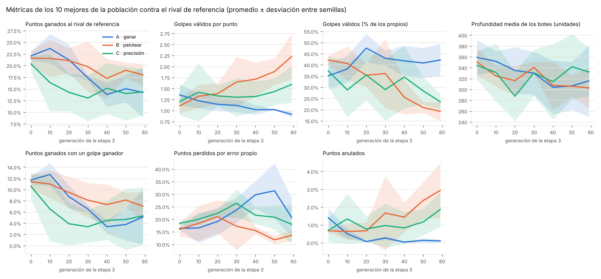
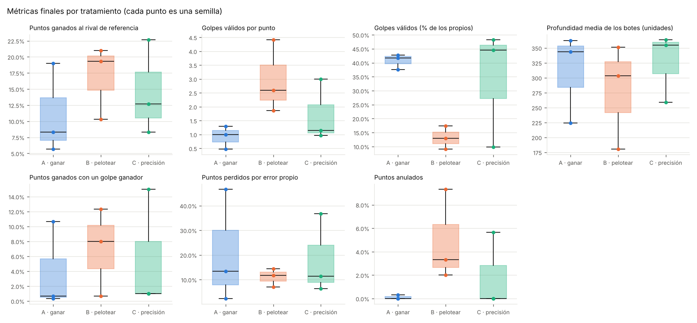
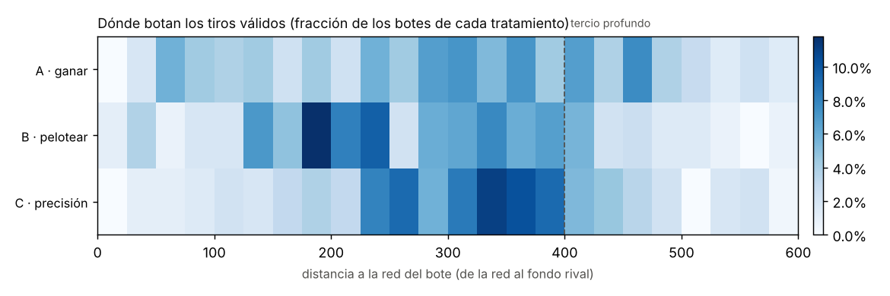
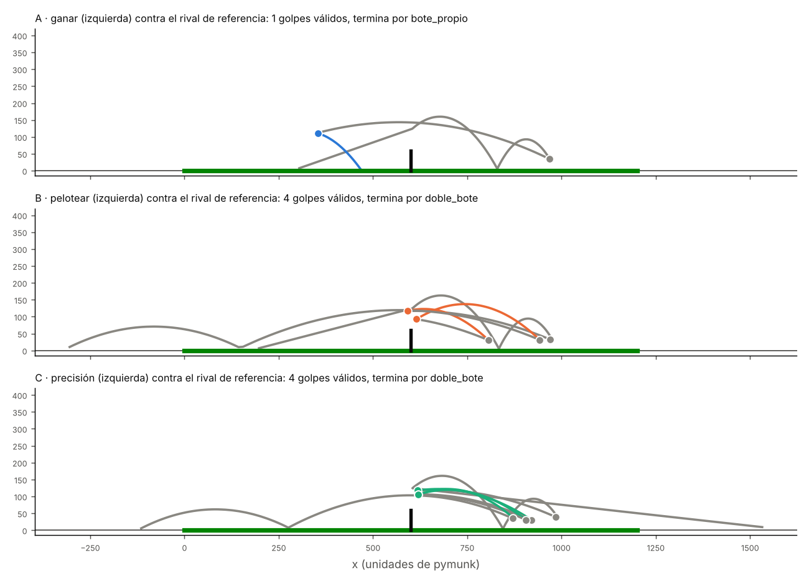

# Capítulo 7 · El experimento (F5)

> Etiqueta: `fase-5` · Archivos: `experimentos.py`, `graficos.py`

## 7.1 Dónde estamos

Todas las piezas están: el juego (capítulo 1), el currículo (4 y 5), las tres
ramas (6) y el análisis (8). El experimento es correrlas **con varias
semillas**, guardar todo y analizar.

Este capítulo tiene dos partes:

1. **Cómo correr el experimento completo** en la laptop del equipo (10
   semillas × 3 tratamientos × 200 generaciones).
2. **Un experimento de ejemplo** que corrimos aquí, más chico, para probar que
   todo funciona de punta a punta y tener gráficos de muestra. **No es el
   resultado del proyecto**: tiene pocas semillas y pocas generaciones.

## 7.2 El diseño, en una tabla

| | Valor | Dónde |
|---|---|---|
| Variable independiente | La aptitud de la etapa 3: A, B o C | `aptitud.APTITUDES` |
| Réplicas | 10 semillas (mínimo 5) | `--semillas` |
| Variables controladas | Física, reglas, red, algoritmo genético, etapas 1 y 2, semillas | `config.py` (no se toca durante el experimento) |
| Variables dependientes | Las métricas de la batería de referencia | `metricas.py` |
| Control clave | Las tres ramas de una semilla parten de la **misma** población base | `experimentos.py` |
| Generaciones de la etapa 3 | 200 | `config.ETAPA3_GENERACIONES` |
| Análisis | Promedio ± desviación, Mann-Whitney entre pares | `graficos.py` |

## 7.3 Cómo correr el experimento completo

### Antes de empezar

1. `git pull` y `pytest`: todas las pruebas deben pasar.
2. **No cambiar `config.py`** durante el experimento. Si hace falta cambiar
   algo, se empieza de nuevo en otra carpeta.
3. Cerrar programas pesados (navegador, juegos) y conectar la laptop al
   cargador, en modo de máximo rendimiento (plan, sección 11).

### El comando

```bash
python experimentos.py --carpeta resultados/experimento --semillas 1 2 3 4 5 6 7 8 9 10
```

Usa todos los núcleos (`--procesos` por defecto). Va imprimiendo cada
generación. **Se puede cortar en cualquier momento** (Ctrl+C, apagar la
computadora): al volver a correr el mismo comando sigue donde quedó, y el
resultado es el mismo que sin cortes (capítulo 4).

### Repartir entre dos laptops

Cada laptop corre semillas distintas **en carpetas con el mismo nombre**:

```bash
# laptop 1
python experimentos.py --carpeta resultados/experimento --semillas 1 2 3 4 5
# laptop 2 (la gamer)
python experimentos.py --carpeta resultados/experimento --semillas 6 7 8 9 10
```

Después se copian las carpetas `semilla_6` ... `semilla_10` de la laptop 2
dentro de `resultados/experimento` de la laptop 1 (por la carpeta en la nube),
y se rearma el resumen y los gráficos:

```bash
python -c "import experimentos; experimentos.resumir('resultados/experimento')"
python graficos.py --carpeta resultados/experimento
```

### ¿Cuánto tarda?

Lo medimos con el experimento de ejemplo (sección 7.5), en la nube con 4
núcleos (Xeon 2,1 GHz):

| Pieza | Tiempo medido (4 núcleos) | Para 200 generaciones |
|---|---|---|
| Currículo (etapas 1 y 2), por semilla | 4,5 a 8 minutos | (igual) |
| Una rama de la etapa 3, 60 generaciones | 9 a 12 minutos | ≈ 30 a 40 minutos |
| **Una semilla completa** (currículo + 3 ramas) | ≈ 40 minutos | **≈ 1 h 50 min** |

En la laptop del equipo (10 núcleos) debería ir unas 2 veces más rápido, o
sea **≈ 50 minutos por semilla**:

| Plan | Una laptop | Repartido en dos laptops |
|---|---|---|
| 10 semillas | ≈ 8 a 9 horas | ≈ 4 a 5 horas |
| 5 semillas (mínimo del plan) | ≈ 4 a 4,5 horas | ≈ 2 a 2,5 horas |

**Antes de lanzar todo, medir**: `python experimentos.py --carpeta resultados/medicion
--semillas 99 --generaciones 10` y mirar la columna "segundos". Si la etapa 3
tarda más de 15 s por generación, conviene repartir entre dos laptops o bajar
a 5 semillas (plan, sección 11).

## 7.4 Qué mirar mientras corre

- La columna **anulados** de la rama B: si sube mucho, puede ser la trampa de
  "congelar" la pelota.
- La columna **promedio** de la rama C: si se acerca a −1, la población está
  dejando de devolver (la trampa del capítulo 6, que ahora se castiga).
- Cada 10 generaciones se guardan las métricas del campeón (`"metricas"`) y
  de los 10 mejores de la población (`"metricas_poblacion"`) en `estado.json`:
  `graficos.py` las usa para las curvas.

## 7.5 El experimento de ejemplo

```bash
python experimentos.py --carpeta resultados/ejemplo --semillas 1 2 3 --generaciones 60
python docs/libro/figuras/figuras_cap07.py --carpeta resultados/ejemplo
```

**3 semillas × 3 tratamientos × 60 generaciones** (el experimento real es 10 ×
3 × 200). Tardó una hora y media con 4 núcleos. Las tres semillas cumplieron
las metas del currículo, con validación:

| Semilla | Etapa 1 (devueltas: prueba / validación) | Etapa 2 (ganados: prueba / validación) |
|---|---|---|
| 1 | gen. 150: 60 % / 60 % | gen. 16: 41 % / 42 % |
| 2 | gen. 81: 70 % / 72 % | gen. 121: 46 % / 43 % |
| 3 | gen. 6: 78 % / 70 % | gen. 156: 41 % / 46 % |

Fíjate en cuánto varía el número de generaciones (de 6 a 150 en la etapa 1):
otra vez, una sola semilla no dice mucho.

### Las curvas



*Figura 7.1. Métricas de los 10 mejores de cada población contra el rival de
referencia, cada 10 generaciones de la etapa 3. Línea: promedio de las 3
semillas; sombra: ± desviación estándar.*

Lo más claro de las curvas:

- **El peloteo se separa:** B pasa de 1,1 a 2,2 golpes válidos por punto; A
  baja de 1,35 a 0,9; C queda en el medio (1,6). Es la dirección que predicen
  H1 (A peloteos cortos) y H2 (B peloteos largos).
- **Los tres tratamientos pierden puntos contra el rival de referencia** (de
  ≈ 22 % a 14–18 %). La coevolución los hace jugar entre ellos, y contra un
  estilo distinto (el rival programado) les va peor. A, el que se entrena para
  ganar, es el que **más** pierde: lo contrario de lo que esperaba H1.
- **Los anulados de B suben** (hasta ≈ 3 %): peloteos tan largos que llegan al
  tiempo máximo. Es lo que el plan pedía vigilar.

### Los valores finales



*Figura 7.2. Métricas finales del campeón de cada rama (cada punto es una
semilla).*



*Figura 7.3. Dónde botan los tiros válidos de cada tratamiento. C concentra sus
botes cerca (pero antes) del tercio profundo; B, más cerca de la red; A los
reparte.*

### Cómo juegan



*Figura 7.4. Un punto típico del campeón final de cada tratamiento (semilla 3,
a la izquierda) contra el rival de referencia. **A** golpea desde el fondo de
su campo. **B** y **C** juegan **pegados a la red** y le devuelven la pelota al
rival en el aire.*

Las partidas grabadas están en `resultados/ejemplo/partido_campeon_A.json`
(y `_B`, `_C`): se pueden ver con `ver2d.py` o `ver3d.py`.

### Dos hallazgos que nadie programó (H4)

**1. Bloquear en vez de golpear.** Contamos qué parte de los golpes de cada
campeón son *pasivos* (la pelota toca la raqueta sin swing, fuerza 0):

| Semilla | Etapa 1 | Etapa 2 | A | B | C |
|---|---|---|---|---|---|
| 1 | 68 % | 100 % | 100 % | 100 % | 100 % |
| 2 | 100 % | 100 % | 42 % | 97 % | 62 % |
| 3 | 86 % | 100 % | 100 % | 100 % | 100 % |

Casi todos los jugadores **no golpean: bloquean**. Ponen la raqueta en el
ángulo justo y dejan que la pelota rebote. Es legal (el modelo de golpe del
capítulo 1 permite el bloqueo), y la evolución lo prefirió desde la etapa 1
porque es más fácil: no hace falta acertar el instante del swing, solo
ubicarse y orientar la raqueta. La "fuerza" del golpe casi no se usa. Es la
lección de Lehman y colaboradores otra vez: la evolución toma el camino más
fácil que permitan las reglas, no el que imaginamos.

**2. "Dejar de jugar" en la rama A.** En la semilla 1, el campeón final de A
casi no toca la pelota (0,05 golpes por punto). Si nadie en la población
devuelve, cada jugador gana sus saques y pierde los del rival: A = 0 para
todos, y nadie tiene ventaja en cambiar. Es un **equilibrio de desconexión**,
una patología conocida de la coevolución. El salón de la fama no alcanzó a
evitarlo en esa semilla.

## 7.6 Qué se puede concluir (y qué no)

Con 3 semillas, **ninguna diferencia puede ser estadísticamente significativa**:
el valor p más chico posible es 0,10 (capítulo 8). Lo que sí muestra el
ejemplo:

- todo el sistema funciona de punta a punta, y es reanudable;
- las tres aptitudes producen **estilos distintos** (peloteo, posición en la
  cancha), en la dirección de H2 para B;
- hay dos fenómenos que el equipo tiene que discutir antes de la corrida
  completa: el bloqueo (¿se deja como hallazgo o se debilita para que haga
  falta golpear?) y la pérdida de puntos contra el rival de referencia.

El resultado del proyecto saldrá del experimento completo, con 5 a 10 semillas
y 200 generaciones.

## 7.7 Para estudiar más

- Diseño de experimentos y réplicas: https://es.wikipedia.org/wiki/Dise%C3%B1o_experimental
- Reproducibilidad en experimentos con computadora: Sandve et al., "Ten
  Simple Rules for Reproducible Computational Research", *PLoS Comput Biol*,
  2013 — https://doi.org/10.1371/journal.pcbi.1003285
