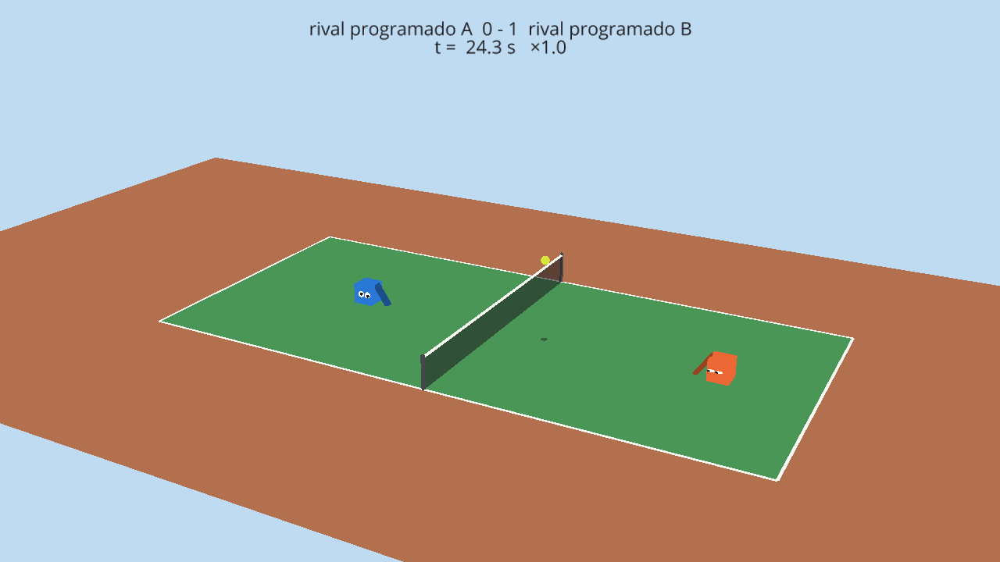

# Capítulo 9 · Visor 3D y humano contra IA (V2 + V3)

> Etiqueta: `fase-4` (se hicieron junto con F3 y F4) · Archivos: `ver3d.py`,
> `jugar.py`, `partido.py` (`Punto`), `ver2d.py` (modo en vivo),
> `tests/test_jugar.py`

## 9.1 Dónde estamos

La feria se gana en dos minutos frente a un jurado. Una curva de aptitud
convence a quien ya sabe qué es una aptitud; ver a dos cubos pelotear en 3D, y
después jugarle tú a la IA, convence a cualquiera. Esta línea de trabajo (R3)
es la de la demo.

## 9.2 El visor 3D

La simulación es **2D**: todo pasa en el plano x-y. El visor 3D no cambia eso:
dibuja ese plano dentro de una cancha con profundidad (eje z, solo visual), con
los jugadores y la pelota en z = 0, y deja mover la cámara alrededor.

```
simulación (x, y)  ──►  Ursina (x · 0,01, y · 0,01, 0)      la cancha mide 12 × 5,5
```

Igual que `ver2d.py`, **solo lee grabaciones**: no importa la física. Por eso
puede reproducir cualquier partido grabado en cualquier computadora.

Detalles y por qué:

| Detalle | Por qué |
|---|---|
| **Sombra bajo la pelota**, más chica cuanto más alta | En 3D cuesta saber a qué altura está la pelota; la sombra en el piso lo resuelve (es el mismo truco de los videojuegos) |
| **Cámara orbital** (`EditorCamera`): clic derecho + arrastrar, rueda para acercar | Para mostrar el partido desde donde se entienda mejor |
| **Rotación automática** (tecla G) | Para dejarlo girando solo en la feria mientras se explica |
| **Cámara de costado al empezar** | De frente, la red (un plano a lo ancho de la cancha) se ve de canto, como una raya |
| **Ojos que miran la pelota** y gestos | Los mismos del visor 2D (capítulo 2): se calculan de la grabación |
| **Ángulo de la raqueta con el signo cambiado** | Ursina gira en sentido horario con ángulos positivos; la simulación, en sentido antihorario |

```bash
pip install -r requirements-3d.txt
python ver3d.py grabaciones/demo.json
python ver3d.py grabaciones/demo.json --lento
```



*Figura 9.1. El visor 3D justo después de un punto (semilla 3). El naranja
ganó: tiene los ojos "felices".*

**Sin pantalla** (en un servidor), la captura necesita una pantalla virtual:
`xvfb-run python ver3d.py grabacion.json --captura cuadro.png --t 5`. En una
laptop normal no hace falta.

## 9.3 Humano contra IA

### Una persona es un controlador más

La interfaz del capítulo 0 lo hace fácil: `ControladorHumano` recibe una
`Percepcion` como cualquier otro, pero arma la `Accion` con las teclas que
están apretadas. `partido.py` no se entera de que juega una persona.

| Tecla | Acción |
|---|---|
| flechas izquierda / derecha | moverse |
| flecha arriba | saltar |
| W / S | raqueta para globo alto / para tiro plano (sin tecla: intermedio) |
| espacio | golpear (fuerza media; con Shift, fuerte; con Ctrl, suave) |

La persona juega siempre a la izquierda (azul), así "derecha" es "hacia la red"
y su marco propio es el del mundo.

### Jugar en vivo: un paso por cuadro

`partido.jugar_partido` juega un punto entero lo más rápido posible (300
veces más rápido que el tiempo real). Para jugar en vivo hace falta lo
contrario: **un paso de física por cuadro de pantalla**, 60 por segundo, y
mientras tanto leer el teclado y dibujar. Por eso el punto se separó en una
clase, `partido.Punto`, con un método `avanzar()`:

- `jugar_punto` llama a `avanzar()` en un bucle hasta que el punto termina;
- `jugar.Juego.cuadro()` lo llama una vez por cuadro.

Es el mismo código en los dos casos, así que la IA juega contra una persona
con exactamente la misma física con que se entrenó. La prueba de
reproducibilidad (`test_misma_semilla_mismo_partido`) confirma que separar la
clase no cambió ningún resultado.

El visor 2D tiene un **modo en vivo**: como no conoce el futuro, la cámara no
puede promediar cuadros que todavía no pasaron (capítulo 2), así que se suaviza
**hacia atrás**: en cada cuadro se acerca un poco al encuadre ideal
(*suavizado exponencial*).

```bash
python jugar.py                                     # contra el rival programado
python jugar.py --campeon resultados/curriculo_s1   # contra el campeón de la etapa 2
python jugar.py --campeon resultados/corto/semilla_1/rama_A --velocidad 0.7
python jugar.py --grabar grabaciones/mi_partida.json   # y después: python ver3d.py grabaciones/mi_partida.json
```

`--velocidad 0.7` hace que el juego vaya más lento: para el público de la
feria, la IA a velocidad real es difícil.

### Probar un juego sin teclado

`tests/test_jugar.py` juega una partida completa con una "persona" simulada
que aprieta teclas según el cuadro, sin abrir ninguna ventana. Por eso
`Juego` está separado de la ventana: se puede probar sola.

## 9.4 Criterios de aceptación

| Fase | Criterio del plan | Resultado |
|---|---|---|
| V2 | Una grabación se ve en 3D en las dos laptops | Comprobado en Linux con pantalla virtual (figura 9.1). **Falta probarlo en las laptops del equipo** (sección 18 del plan) |
| V3 | Una persona juega contra el rival programado y luego contra un campeón | `jugar.py` con y sin `--campeon`; la partida se prueba sin teclado en `test_jugar.py`. **Falta que una persona lo juegue** |
| V4 | Demo estable de 10 minutos, videos | Pendiente (diciembre) |

## 9.5 Para estudiar más

- Ursina, documentación y ejemplos — https://www.ursinaengine.org/documentation.html
- Bucle de un videojuego (leer entrada, actualizar, dibujar) —
  https://gameprogrammingpatterns.com/game-loop.html
- Suavizado exponencial — https://es.wikipedia.org/wiki/Suavizamiento_exponencial
